# Correction Layer

**Turn the corrections you give once into checks that are applied whenever that kind of work is checked or sent through it: proposals, spreadsheets, PDFs, records. No Git, no terminal, no JSON required.**

> **Status: design, plus a local MVP implementation (Phase 1 framework + Phase 2 functions, 2026-11-21).** The documents, schemas and examples in this repository are a specification: every schema and example file is a *proposed* contract, and the example files are not the output of running software. Alongside them there is a **local-first implementation** (`src/`, `test/`) that builds, starts and passes its tests. It is **not the finished product**: one person, one machine, Markdown/plain-text quotes only, a command-line capture adapter but no connected assistant, and release either simulated or copied to a local folder you choose. Nothing is sent or paid, and no AI model is used. See [Implementation status](#implementation-status-phase-1-and-phase-2), [HANDOFF.md](HANDOFF.md) and [PHASE2_COVERAGE.md](PHASE2_COVERAGE.md). Nothing here has been measured; performance figures are stated goals.

## The idea in one minute

When you correct someone's work ("that price is out of date", "this customer's quotes must be in SGD"), the correction usually lives in a chat message or in someone's memory. It gets forgotten, or it gets pasted into an ever-growing list of instructions that nobody, human or AI, reliably follows.

Correction Layer takes a different route:

```text
  You correct something once
          |
          v
  It becomes a plain-language rule               "Meridian Clinics quotes are in SGD"
          |                                      Either you review it, or, where you
          |                                      have switched learning on for a
          |                                      project, a low-risk rule that passes
          |                                      its tests turns itself on and tells you
          |                                      (scope: this customer; tested on a
          v                                       bad example and a good example)
  The rule is applied whenever relevant work is checked,
  and always before a send that goes through the product
          |
          v
  Problems are shown at the exact place          "Pricing table, row 1: USD 1,180.00;
  with a suggested fix                            price list says SGD 1,650.00"
          |
          v
  Someone fixes it; the work is checked again
          |
          v
  A person approves the send / export / submit   <- separate from the check passing
          |
          v
  Everything above is visible afterwards as a timeline you can read
```

Five things it is careful about:

- **A check finds problems; it does not fix them.** Detecting, suggesting a fix, changing the document, approving, and sending are five separate steps by identifiable actors, and the product shows them separately.
- **A pass is not permission.** "Ready" means the work met specific rules, at a specific time, against specific trusted sources. Whether the consequential step happens is a separate decision by a person (or, for low-risk actions, a standing decision a person has recorded in advance).
- **It only enforces where it actually sits in the path.** If you send a file through a route the product controls (called a *gateway* in these documents), it can block. If you attach the file to an email yourself, it cannot, and the product says so plainly instead of implying otherwise.

- **Noticing corrections is the product's job, not the assistant's memory.** Where you connect a supported app or assistant, what you type, edit or reject is delivered to the product durably, with acknowledgements, replay after a crash, and a visible warning when something is missing. Delivery being reliable does not make understanding perfect: a correction can still be missed or misread, so there is a queue where you can see what was captured, what was understood, and fix either. Apps that are not connected are not seen.
- **Rules can add themselves, inside limits you set once.** You can switch on learning for a project. Then a low-risk rule (an exact check, for that project only, that adds a requirement and passes tests on real work) turns on without a click, with a notice and Undo. Anything broad, consequential, ambiguous, or that would loosen a rule or change who may do what, still waits for a person. Every rule records whether a person approved it individually or it came in under that standing permission.

It generalizes [encode-the-correction](https://github.com/somethingwentwell/encode-the-correction), a developer tool that turns corrections to coding agents into deterministic checks run automatically whenever code changes ("CI"), to everyday non-developer work. It is agent-neutral, meaning it is not tied to any one AI assistant: any assistant, or none at all, can use it.

## The concerns this design answers

| # | Concern | Where it is designed |
|---|---------|----------------------|
| 1 | The rule list keeps growing, but every relevant check must still run | [Architecture §10](docs/03-architecture.md#10-keeping-a-growing-rule-set-enforceable), [Context and scope §5](docs/04-context-and-scope.md#5-which-rules-apply-deterministic-scope-matching) |
| 2 | Corrections differ per project and folder; every session and artifact needs the right context | [Context and scope](docs/04-context-and-scope.md) |
| 3 | Documents, spreadsheets, PDFs and records each need the correct checks | [Formats](docs/05-formats.md) |
| 4 | Ordinary users must get started easily and understand the interface | [Product and UX](docs/01-product-ux.md) |
| 5 | Users must be able to *see* the rules, what changed, what was blocked, when checks ran, and what was fixed | [Observability](docs/02-observability.md) |
| + | Corrections should be captured reliably and turned into rules automatically where that is safe | [Learning](docs/12-learning.md), [Enforcement §11](docs/06-enforcement-and-integration.md#11-capture-adapters) |

## Document map

Read in this order if you are new. The first three are written for non-developers.

| Document | What it covers |
|----------|----------------|
| [docs/01-product-ux.md](docs/01-product-ux.md) | Who it is for, getting started, the main screens (wireframes), turning a correction into a rule, approving an action |
| [docs/02-observability.md](docs/02-observability.md) | Seeing rules, history, run timelines, before/after comparison, effectiveness; the event model behind them |
| [examples/sales-proposal/README.md](examples/sales-proposal/README.md) | Full worked example: outdated price, wrong currency, authoritative price list, tests, failure, repair, recheck, separate send approval |
| [examples/vendor-payments/README.md](examples/vendor-payments/README.md) | Second domain (a payment spreadsheet) showing the same model generalizes |
| [docs/03-architecture.md](docs/03-architecture.md) | Components, local store, rule model, check catalog, evaluation, rule growth |
| [docs/04-context-and-scope.md](docs/04-context-and-scope.md) | Workspaces, projects, folders, moved and copied files, sessions, which rules apply and why |
| [docs/05-formats.md](docs/05-formats.md) | Typed artifacts, provenance back to cells/sections/pages, format adapters, support matrix |
| [docs/06-enforcement-and-integration.md](docs/06-enforcement-and-integration.md) | Advisory versus gateway enforcement, validation receipts, approvals, action adapters, agent handshake, offline behaviour |
| [docs/07-security-and-governance.md](docs/07-security-and-governance.md) | Threat model, roles, exceptions, privacy, isolation, audit integrity, known limitations |
| [docs/08-mvp-and-acceptance.md](docs/08-mvp-and-acceptance.md) | Phased plan, narrow MVP, acceptance tests per concern, performance goals |
| [docs/09-decisions.md](docs/09-decisions.md) | Decision records (ADRs) with the alternatives that were rejected |
| [docs/10-open-questions.md](docs/10-open-questions.md) | Unresolved questions, each with a recommended default |
| [docs/11-critique-of-concept-draft.md](docs/11-critique-of-concept-draft.md) | What changed from the earlier concept draft and the working hypotheses, and why |
| [docs/12-learning.md](docs/12-learning.md) | Reliable capture of corrections, automatic detection, tests, and rules that turn on by themselves inside limits a person sets once |
| [examples/learning/README.md](examples/learning/README.md) | Worked cases: a rule added with no click, a one-off that is not learned, a malicious document ignored, a lost connection recovered, a contradiction that pauses a learned rule |
| [docs/glossary.md](docs/glossary.md) | Screen words and their technical equivalents |
| [schemas/README.md](schemas/README.md) | Proposed JSON Schemas for rules, artifacts, runs, receipts, actions, context, events |

## Where visual observability lives

Observability is a product capability with its own screens and data model, not a log file. These files cover it:

| Need | File |
|------|------|
| Screens: rules overview, rule detail, activity history, run timeline, before/after compare, correction journey, effectiveness, coverage map | [docs/02-observability.md](docs/02-observability.md) |
| Event envelope, event catalogue, entity relationships, causality links | [docs/02-observability.md §3–4](docs/02-observability.md#3-the-data-model-behind-the-screens), [schemas/event.schema.json](schemas/event.schema.json) |
| Per-run record: every in-scope rule with outcome, evidence, location, and why it ran or did not | [schemas/run.schema.json](schemas/run.schema.json) |
| A concrete journey a non-technical reader can follow, with a 37-event timeline | [examples/sales-proposal/README.md](examples/sales-proposal/README.md), [examples/sales-proposal/events.json](examples/sales-proposal/events.json) |
| What was captured, what was understood, what turned on by itself and why; capture health and gaps | [docs/02-observability.md §11](docs/02-observability.md#11-capture-and-learning-views), [docs/12-learning.md §10](docs/12-learning.md#10-the-learning-queue-and-reconciliation) |
| A learned rule followed from the captured sentence to the block it later caused | [examples/learning/README.md](examples/learning/README.md), [examples/learning/events.json](examples/learning/events.json) |
| Redaction, permissions, retention for traces | [docs/02-observability.md §9](docs/02-observability.md#9-redaction-permissions-and-retention) |
| Acceptance tests for reconstructing a correction end to end, and for project isolation | [docs/08-mvp-and-acceptance.md](docs/08-mvp-and-acceptance.md#5-acceptance-tests) |
| What the MVP includes (rule list, event timeline, diff and recheck) versus later analytics | [docs/08-mvp-and-acceptance.md](docs/08-mvp-and-acceptance.md#2-phases) |

## What this is not

- Not a guarantee that work is correct. Rules catch the mistakes someone has already described; new kinds of mistake pass until someone corrects them.
- Not a way to make an AI assistant obey. Instructions to an assistant are advisory. Only actions routed through a registered gateway can be blocked.
- Not a judge of quality. "Is this persuasive?" stays a human or advisory matter and is never shown as a hard guarantee.
- Not a general automation platform, and not a place to embed scripts. Rules are data, chosen from a fixed list of check types that ships with the product.
- Not able to see apps or assistants that are not connected to it, and never a way around an app's own permissions.
- Not a system that learns anything it likes. It can only add checks; it cannot switch one off, grant an exception, or change who may approve or send.

## Implementation status (Phase 1 and Phase 2)

The design documents above stay the source of truth, and their "nothing is implemented" banners describe the design as written. What exists in code today is deliberately narrower: [HANDOFF.md](HANDOFF.md) lists exactly what is real and simulated, and [PHASE2_COVERAGE.md](PHASE2_COVERAGE.md) lists what Phase 2 added, which acceptance tests now pass, and what is still deferred.

Requirements: Node.js 24 or newer (built-in SQLite; TypeScript runs directly). No runtime dependencies; `npm install` only fetches the TypeScript compiler.

```sh
npm install            # TypeScript toolchain only
npm run verify         # type check, build, tests (deferred contracts are "todo", never passing), design checker

cp .env.example .env   # optional; no secrets are needed
npm run dev            # start from source with reload (loopback only, port 4319)
npm start              # start the built service (after npm run build)
npm run cli -- capture say --adapter adp_... --outbox ./outbox.jsonl "Quotes must always be in SGD."
```

Then open `http://127.0.0.1:4319/`. On an empty workspace the home page offers three ways in: **Start new** (a guided setup: project, first quote, optional first rule, first check explained), **Import existing** (Markdown or plain-text quotes and CSV price lists, previewed before anything is saved, never overwriting), and **Try a fictional demo** (clearly labelled DEMO data, only into an empty workspace; or start with `CL_SEED_DEMO=1`). For a step-by-step first session with real screenshots, see [Your first walkthrough, with screenshots](#your-first-walkthrough-with-screenshots) below.

| Real | Simulated, partial or unavailable (and labelled so in the product) |
|------|---------------------------------------------------------------------|
| Projects, folders, facts, trusted sources with CSV import (bad rows reported, never read as zero) | Word, Excel and PDF documents: *Couldn't verify*. XLSX sources: export to CSV |
| A correction editor with plain options, a dry run on your documents, overlapping rules shown before saving, real examples, change, pause with an end date, exceptions | Folder markers, moved/copied folders, folder watching |
| Ten check kinds evaluated deterministically; rules selected by scope index, never by search | Attestation and spreadsheet check kinds; AI opinions |
| Learning under a policy you set: 7 English correction patterns, tests on real versions, automatic activation only when low-risk, automatic pause of learned unconfirmed rules, inbox actions, "this was a correction", deleting wording | Free-form understanding, other languages, any AI model |
| Durable capture: acknowledgements, replay, duplicates, gaps (acknowledge as lost), dead letters (retry), a command-line adapter over loopback HTTP, transcript backfill capped at the inbox | No assistant, chat app, email or office app is connected: each is named NOT CAPTURED |
| Content diff of passages and values, re-run as recorded, a correction's journey by stored references, proposed changes kept apart from applied changes | Document preview with highlighted findings |
| Receipts, approval by a person, a gateway that re-verifies every binding; release to a local folder you choose (exactly the checked bytes, never overwriting), with a newer-version choice | Send and pay do not exist. Release is simulated unless you choose a folder |

## Your first walkthrough, with screenshots

This is one real session in the local app, captured in a browser from an empty workspace. Everything in it is **fictional**: "Willowbank Veterinary Group" and its quotes and prices are made up. The fictional demo was **not** loaded; every step uses **Start new** or **Import existing**. The sample files are in [examples/readme-walkthrough/](examples/readme-walkthrough/README.md) (fictional / illustrative), so you can repeat the walkthrough yourself.

What you will do: create a project, add a quote priced in USD, add a rule that the quote should be in SGD, see the first check explain the problem, import the corrected quote, an addendum and a price list, check again, and compare before with after.

**Before you start.** Run `npm install` and `npm run dev` as shown [above](#implementation-status-phase-1-and-phase-2), then open `http://127.0.0.1:4319/`. To see the first-run home page you need an empty workspace. If you have used the app before, point `CL_DATA_DIR` at a new, empty folder in your `.env` (see `.env.example`).

Two things to know first:

- **A rule added during Start new starts as a note.** A note is shown on every check but never blocks. So in step 5 the USD quote is **Ready with 1 note**, not blocked. You can make a rule must-pass later, on its own page.
- **Ready is evidence, not permission.** A Ready check comes with a receipt, and the app says so: "It is evidence, not permission." Releasing is a separate act by a person. In this build release is simulated (or a copy to a local folder you choose), and **send and pay do not exist**. This walkthrough never presses **Request release (SIMULATED)**.

### 1. Open the app and choose Start new

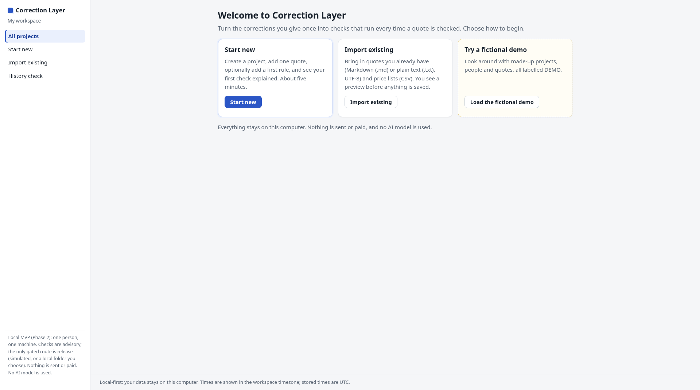

*The empty workspace offers three ways in. Click **Start new**. The line under the cards says it plainly: everything stays on this computer, nothing is sent or paid, and no AI model is used.*

### 2. Create the project

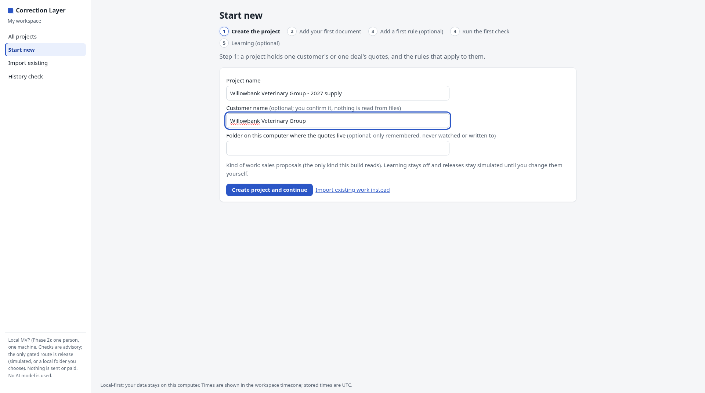

*Type a **Project name** (here `Willowbank Veterinary Group - 2027 supply`) and, optionally, a **Customer name** (`Willowbank Veterinary Group`). The folder field was left blank. Learning stays off and releases stay simulated until you change them yourself. Click **Create project and continue**.*

### 3. Add your first document

Choose [examples/readme-walkthrough/01-usd/Willowbank-Quote-2027-01.md](examples/readme-walkthrough/01-usd/Willowbank-Quote-2027-01.md) (Markdown or plain text, UTF-8) and click **Add document**. The app shows what it read: customer Willowbank Veterinary Group, quote reference WV-2027-014, valid until 2027-03-18, total **USD 5,700.00**, and 2 pricing table lines. Check that this matches the file: every check works on what was read.

### 4. Add an optional first rule

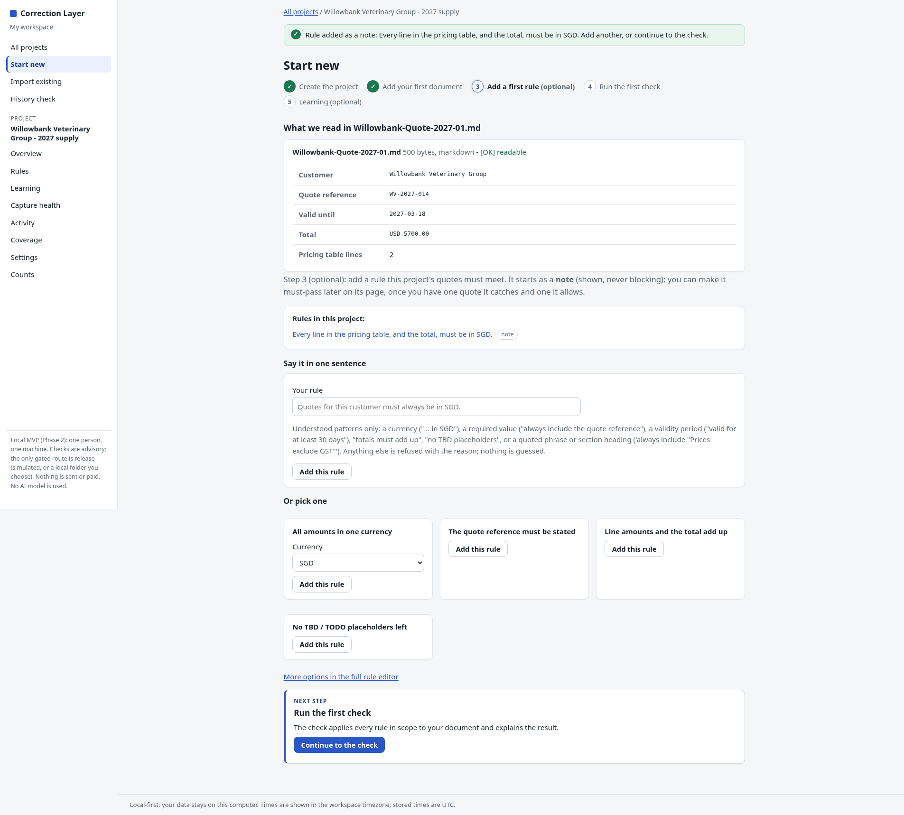

*Under **Or pick one**, in **All amounts in one currency**, leave the currency at **SGD** and click **Add this rule**. The confirmation reads "Rule added as a note". Under "Rules in this project" the rule carries a **note** badge, not must-pass. Then click **Continue to the check**.*

### 5. Run the first check and read the result

On step 4 the Willowbank quote, version 1, is already selected. Click **Run the check**.

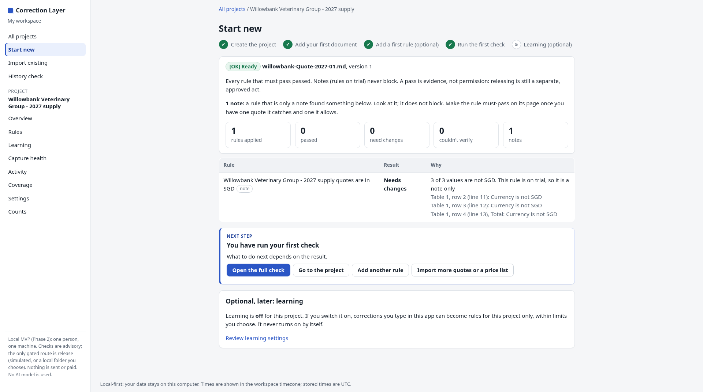

*The result is **[OK] Ready** with **1 note**. That is correct, not a mistake: the SGD rule is only a note, so it reports the problem without blocking. Its explanation says "3 of 3 values are not SGD": table rows 2 and 3, and the total in row 4. The page also says "A pass is evidence, not permission". The learning card at the bottom confirms learning is **off** for this project. Click **Open the full check**.*

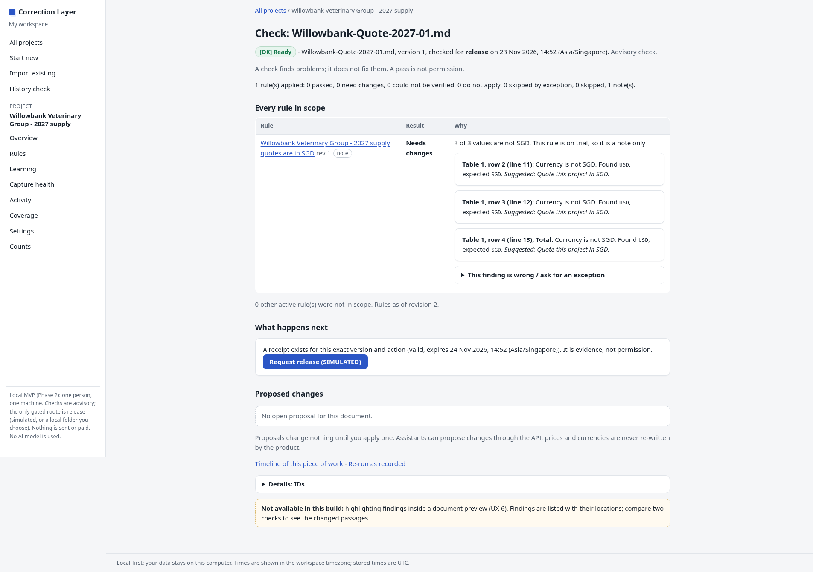

*The full check lists every rule in scope, each finding with its location ("Table 1, row 2 (line 11)") and a suggested fix. A check finds problems; it does not fix them. The receipt box says the receipt "is evidence, not permission". The **Request release (SIMULATED)** button was not used.*

### 6. Import the corrected quote and an addendum

Open **Import existing** from the sidebar. Keep the Willowbank project selected, choose both [02-sgd-corrected/Willowbank-Quote-2027-01.md](examples/readme-walkthrough/02-sgd-corrected/Willowbank-Quote-2027-01.md) and [Willowbank-Addendum-2027-02.md](examples/readme-walkthrough/Willowbank-Addendum-2027-02.md), and leave "If a document with the same name already exists" at **Add it as a new version**.

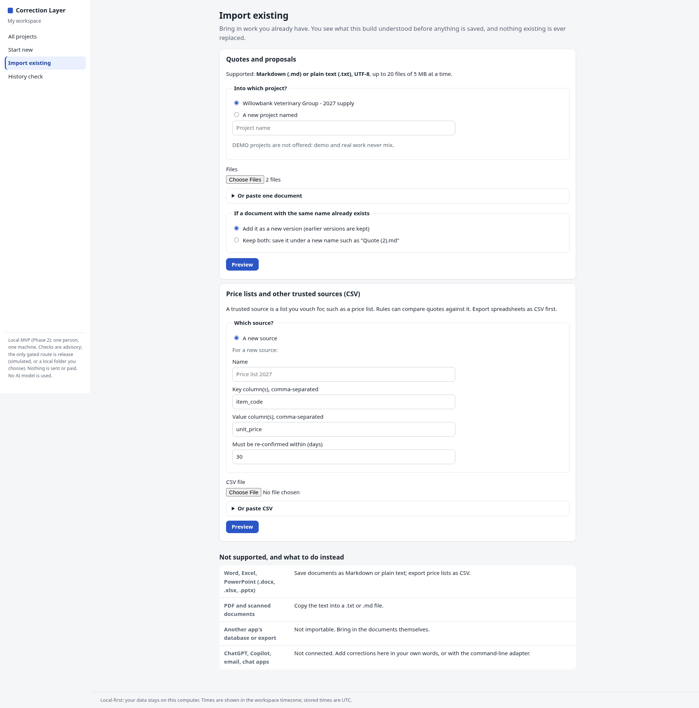

*Under **Quotes and proposals**, click **Preview**. The bottom of the page lists what is **not supported**: Word, Excel and PowerPoint files (save them as Markdown or plain text, and export price lists as CSV), PDFs and scanned documents (copy the text into a .txt or .md file), and another app's database (not importable). Assistants, email and chat apps are not connected.*

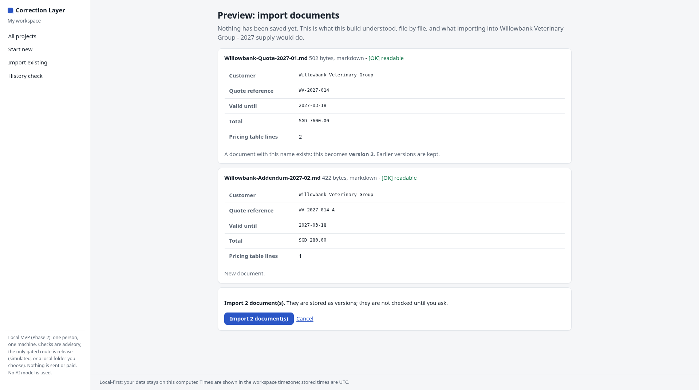

*Nothing has been saved yet. The corrected quote has the same name, so it **becomes version 2** (total SGD 7,600.00), and earlier versions are kept. The addendum is a **new document** (SGD 280.00). Click **Import 2 document(s)**.*

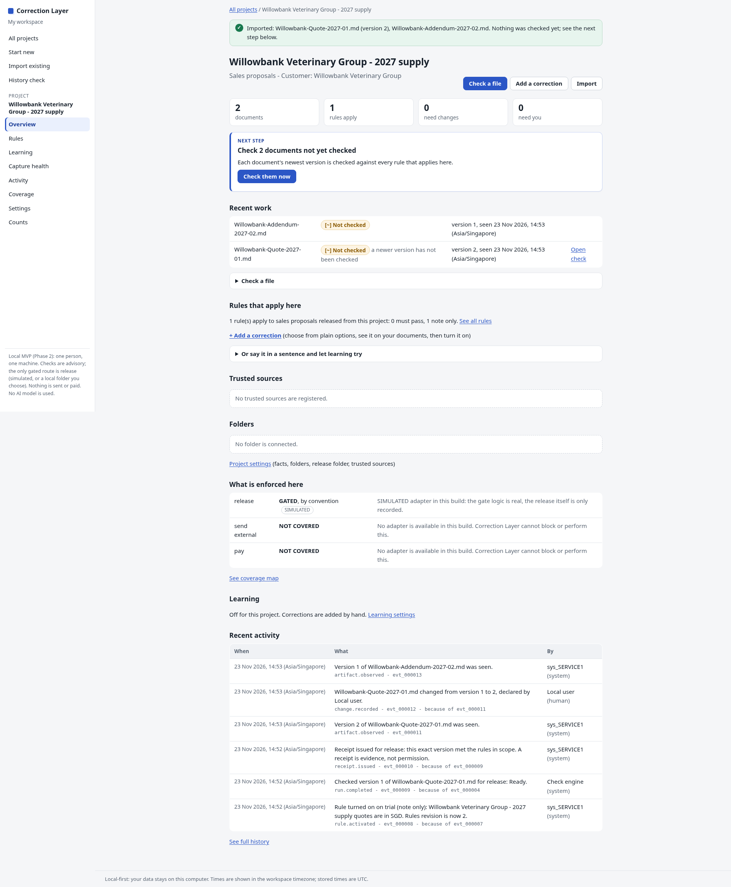

*Both files are stored, and both are marked **Not checked**. Importing never checks anything by itself. Leave **Check them now** for step 8. This page also shows what is enforced: release is GATED but SIMULATED, and send and pay are NOT COVERED.*

### 7. Import a price list (CSV)

Open **Import existing** again and scroll to **Price lists and other trusted sources (CSV)**.

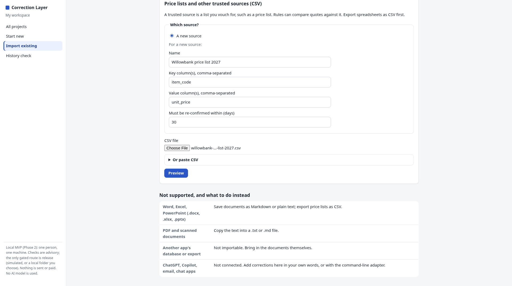

*Choose **A new source**, name it `Willowbank price list 2027`, keep the key column `item_code`, the value column `unit_price` and 30 days, choose [willowbank-price-list-2027.csv](examples/readme-walkthrough/willowbank-price-list-2027.csv), and click **Preview**.*

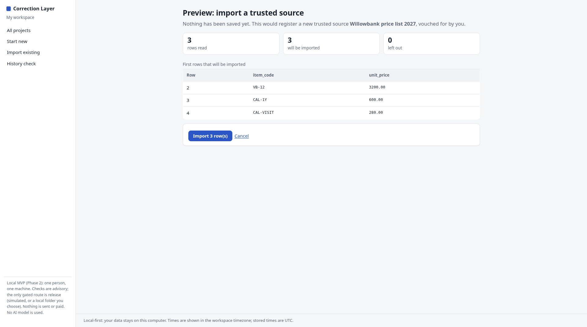

*Nothing is saved yet: 3 rows read, 3 will be imported, 0 left out. Rows that cannot be read are listed and left out; they are never read as zero. Click **Import 3 row(s)**. The source page then shows 3 of 3 rows imported. (No price rule uses this list in this walkthrough. To make quotes match it, add a rule such as "Unit prices must match a trusted price list".)*

### 8. Check again

Go back to the project (**Overview** in the sidebar) and click **Check them now**. Both new documents are checked. Open the check of the quote's version 2.

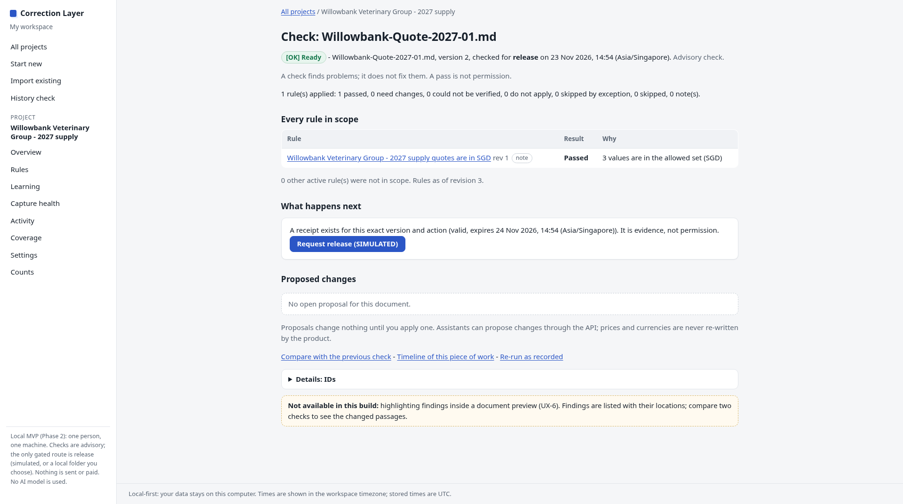

*Version 2 is **Ready** and the SGD rule now **Passed**: "3 values are in the allowed set (SGD)", with 0 notes left. The receipt is again evidence, not permission, and release was not requested. Click **Compare with the previous check**.*

### 9. Compare before with after

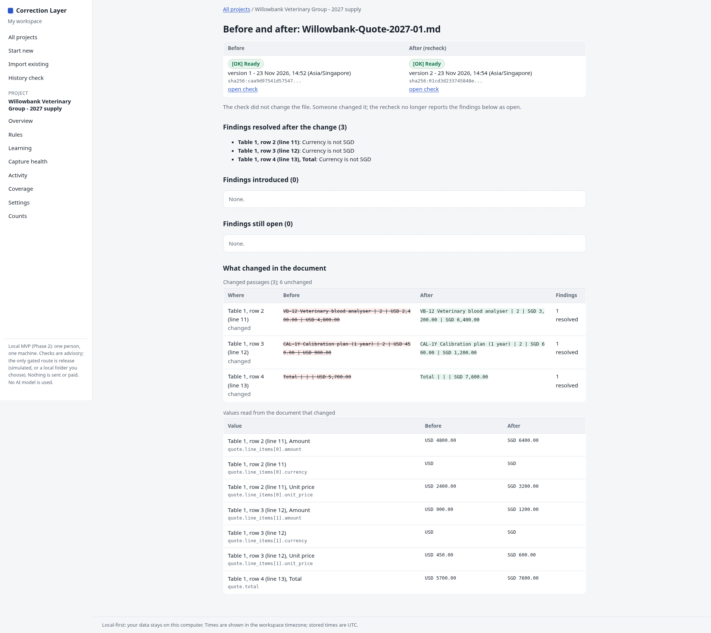

*The comparison shows **3 findings resolved**, **0 introduced** and **0 still open**, and exactly which lines and values changed: USD 2,400.00 → SGD 3,200.00, USD 450.00 → SGD 600.00, total USD 5,700.00 → SGD 7,600.00. The page says plainly that the check did not change the file: a person did, and the recheck no longer reports those findings.*

<details>
<summary>More screenshots from the same session (in-between steps and the final project page)</summary>

**Start new, step 1, before typing.** The five steps are listed at the top: create the project, add your first document, add a first rule (optional), run the first check, learning (optional).

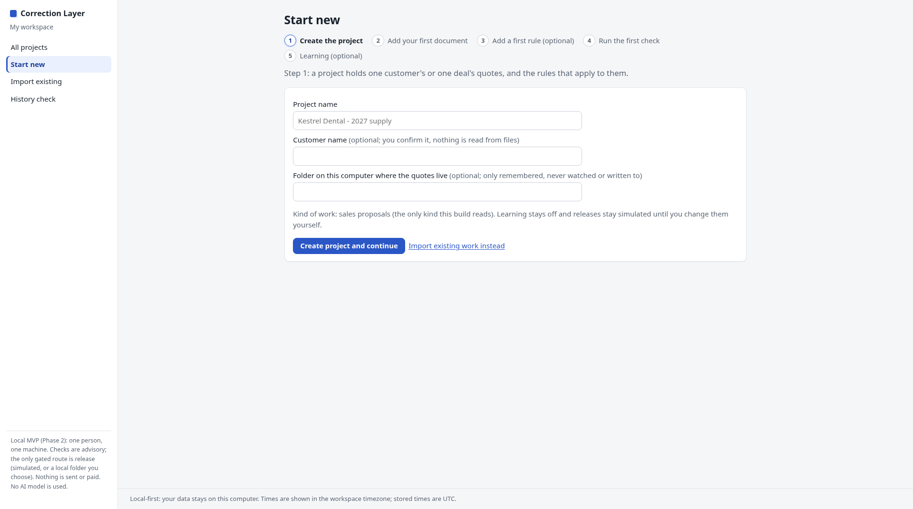

**Step 2, add your first document.** Upload a Markdown or plain-text file, or paste the text.

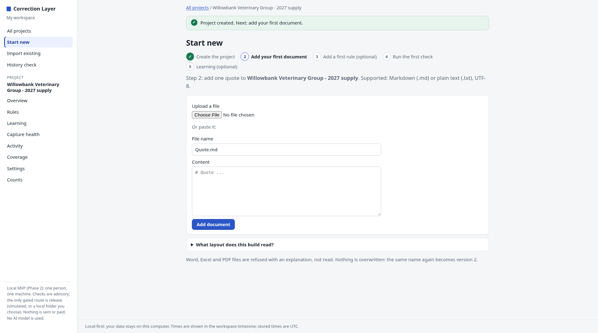

**Step 2, file chosen.** The USD quote is selected; nothing is stored until you click **Add document**.

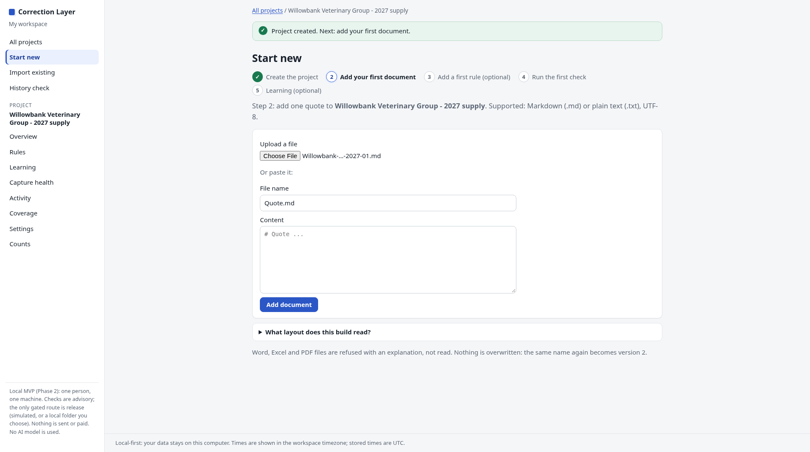

**Step 3, what was read, before adding a rule.** Every rule starts as a note. The sentence box understands a few fixed patterns only, and refuses anything else with the reason; nothing is guessed.

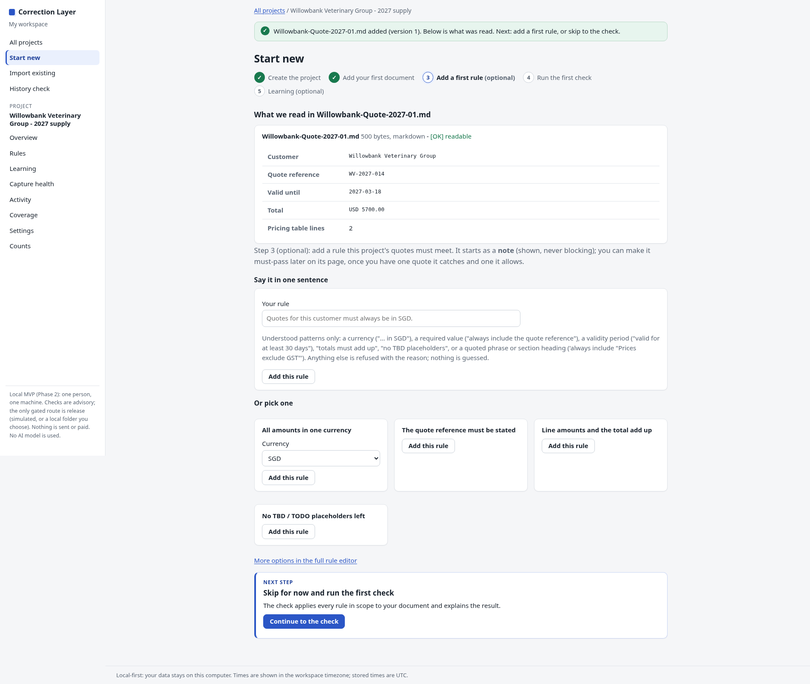

**Step 4, run the first check.** Version 1 of the quote is selected; the check is advisory.

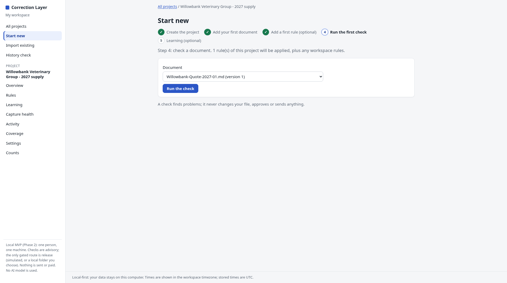

**The price list after Import 3 row(s).** 3 of 3 rows imported; every row was usable.

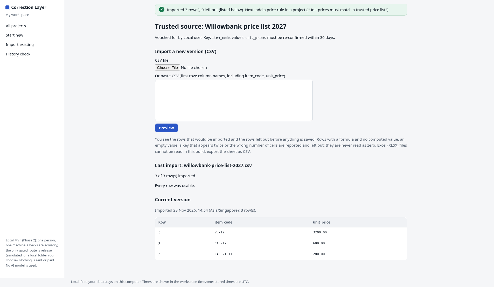

**The project at the end.** Both documents are Ready, the trusted source is listed, one rule applies (a note, 0 must-pass), learning is still off, and send and pay are NOT COVERED.

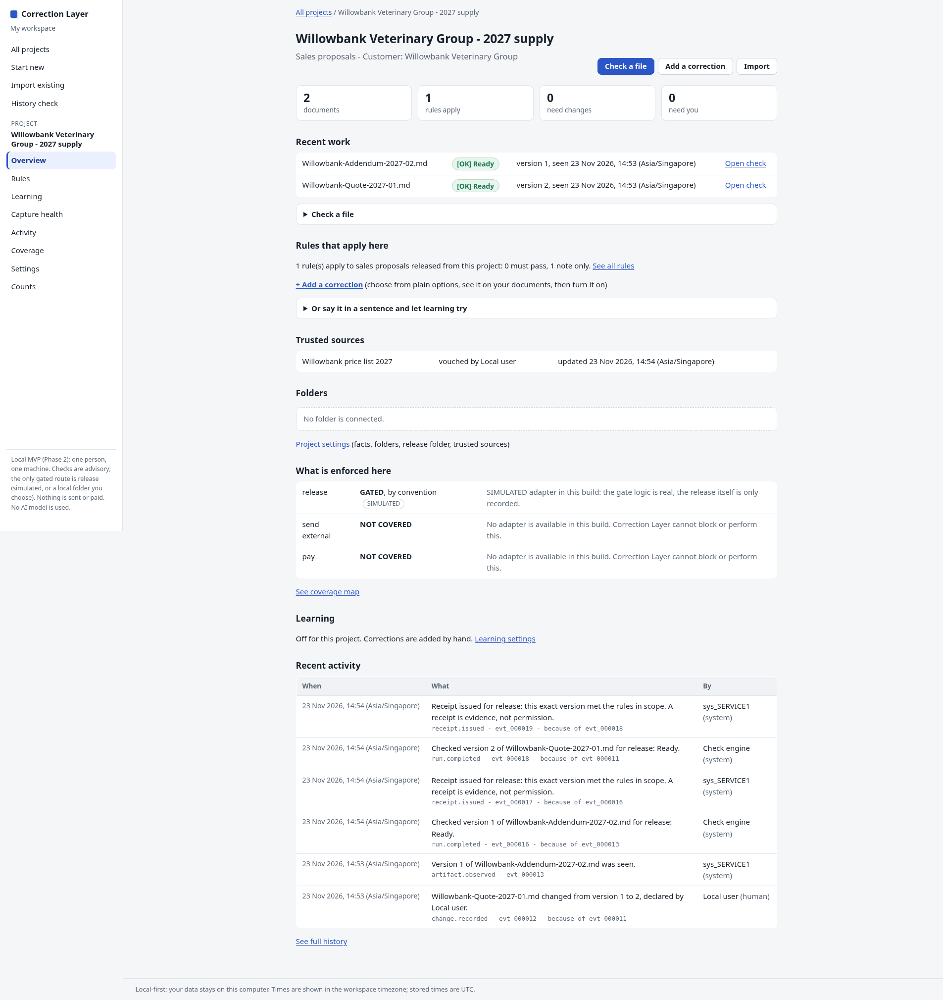

</details>

**What this walkthrough did not do.** It did not switch learning on, request a release, or make the rule must-pass. Send and pay do not exist in this build. Word, Excel, PowerPoint and PDF files are not read (see the Not supported table in step 6). [HANDOFF.md](HANDOFF.md) lists what is real and what is simulated.

## Checking this repository

The repository contains one small, dependency-free maintenance script. It is not part of the product; it only keeps the design documents honest. (It skips the implementation's toolchain files and output: `node_modules/`, `dist/`, and the root `package*.json` / `tsconfig*.json`.)

```sh
python3 tools/check_repo.py
```

It verifies that internal links and anchors resolve, that every JSON file and every `json` code block parses, that example files validate against their proposed schemas, that the example event timelines are causally ordered and hash-chained, and that wireframes are aligned. For the learning examples it also recomputes every automatic decision from its recorded inputs, replays the capture stream through the documented intake procedure, and confirms that no rule in any example was activated without either a person's approval or a learning policy a person had set earlier.

## Repository layout

```text
README.md
HANDOFF.md   what the Phase 1 scaffold implements, and what Phase 2 must complete
docs/        design documents (start with 01 and 02)
docs/screenshots/            real browser screenshots used by the README walkthrough
examples/    worked examples with proposed fixture files
examples/readme-walkthrough/ fictional sample files for the README walkthrough (not design fixtures)
schemas/     proposed JSON Schemas (draft 2020-12 subset); also the scaffold's wire contracts
src/         Phase 1 framework scaffold (TypeScript, runs on Node 24)
test/        baseline tests for the scaffold
tools/       check_repo.py - consistency checks for the design documents only
```
