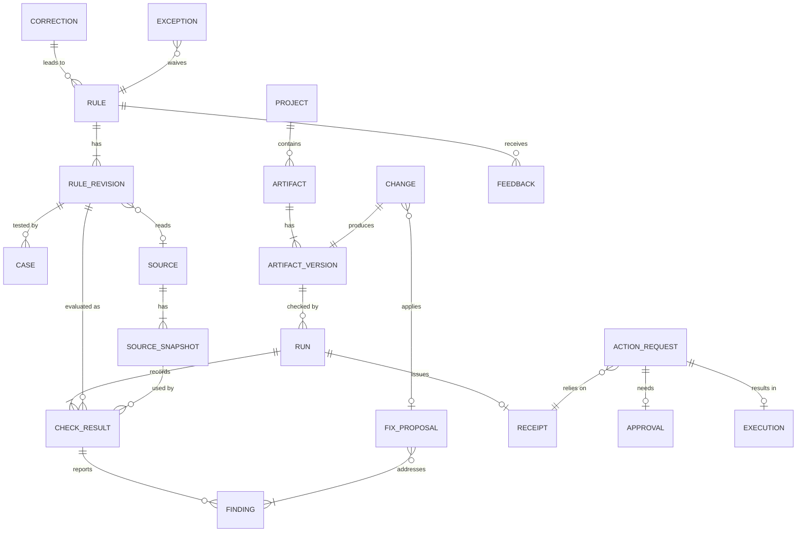

# 02 · Visual observability

> Proposed design. Nothing in this document is implemented. Wireframes are illustrations; any figures inside them are placeholders, not results.

Observability here is not a log viewer. It is the part of the product that lets a non-technical person answer, by looking:

1. **What rules exist**, where do they apply, and who owns them?
2. **What was added, changed or turned off**, by whom, and who approved it?
3. **What does each rule allow, require or block**, with real examples?
4. **When was a rule triggered** on a piece of work, why, with what evidence, and what happened next?
5. **What changed in the work afterwards**, who changed it, and did the recheck pass?

**How to read this document.** Sections 1, 2, 5, 6, 7 and 8 are written for everyone: what you can see and what it means. Sections 3, 4 and 9 describe the data behind the screens and are mainly for people who will build or audit the product; skip them on a first read.

The screens in this document are *projections of one append-only record* (the ledger, §4). There is no separate "analytics database" that could drift from what happened. If a screen shows it, an event backs it; if no event backs it, the screen does not claim it.

## 1. Five verbs, kept apart

The interface and the data model keep five kinds of act separate, because conflating them is how tools end up claiming more than they did.

| Verb | Who can do it | What is recorded | Screen label |
|------|---------------|------------------|--------------|
| **Detect** | The check engine only | A run with one result per in-scope rule, findings with locations and evidence | "Checked" |
| **Propose a fix** | The engine (derived from a trusted source) or an assistant or a person | A fix proposal linked to findings; never applied automatically | "Suggested" |
| **Change the work** | A person, or an assistant acting for a named person | A change linking the version before to the version after, with a diff and attribution | "Changed by …" |
| **Approve** | A person with the right role | An approval bound to an exact version, action and recipient | "Approved by …" |
| **Execute** | A registered action adapter behind the gateway | An execution with the adapter's outcome | "Sent / Exported by …" |

**Checks do not improve artifacts.** A check produces findings. Improvement, when it happens, is a *change made by someone* followed by a *recheck that no longer reports the finding*. The product states exactly that ("4 findings resolved after the change by Priya's assistant at 10:09") and nothing stronger.

## 2. What a user can see (overview)

| Screen | Question it answers | In MVP? |
|--------|---------------------|---------|
| OBS-1 Rules overview | What rules exist? Filter, search, scope | Yes |
| OBS-2 Rule detail | What does this rule require/allow/block? Examples, scope, history | Yes |
| OBS-3 Activity | What was added, changed, disabled, approved? | Yes |
| OBS-4 Run timeline | What happened to this piece of work, step by step? | Yes |
| OBS-5 Before/after compare | What exactly changed between two versions, and which findings did it resolve? | Yes (text and table cells) |
| OBS-6 Correction journey | From one human correction to its effects | Yes (simple list form) |
| OBS-7 Effectiveness | Is the rule still catching things? Is it wrong often? | Later (basic counts in MVP) |
| OBS-8 Coverage map | Where is enforcement real, and where is it advisory? | Yes |

## 3. The data model behind the screens



Key relationships, in words:

- A **correction** is the original human statement, kept verbatim with who said it, when, and what it was about (artifact and location, if any). A correction can lead to zero, one or several rules, and a rule always points back to its origin (a correction, a starter pack, or an imported pack).
- A **rule** has immutable **revisions**. Edits create a new revision; old revisions remain readable and remain attached to the runs that used them.
- An **artifact** is a piece of work followed across saves, renames and moves; each distinct content is a **version** identified by its content hash.
- A **run** is one check of one artifact version, for one intended action, in one resolved context, against one policy revision and specific source snapshots. A run holds a **check result for every rule that was in scope**, not only failures.
- A **finding** is one located problem. A **fix proposal** addresses one or more findings. A **change** is the transition from one artifact version to the next, optionally linked to the fix proposal it applied.
- A **trace** groups everything about one artifact heading toward one action: runs, fix proposals, changes, receipts, approval, execution. It is what the timeline screen shows.
- A **journey** is not stored; it is the path through these links starting from a correction (§5.6).

Proposed shapes: [run.schema.json](../schemas/run.schema.json), [rule.schema.json](../schemas/rule.schema.json), [event.schema.json](../schemas/event.schema.json).

## 4. The event model

### 4.1 Envelope

Every state change appends one event. The envelope (proposed, see [event.schema.json](../schemas/event.schema.json)):

| Field | Purpose |
|-------|---------|
| `event_id`, `seq` | Stable identifier and strictly increasing position in the workspace ledger. `seq` order is the authoritative order |
| `type` | One of the catalogue in §4.2 |
| `occurred_at` | Real event time in UTC (RFC 3339). Screens render it in `display_tz` |
| `display_tz` | IANA timezone the workspace displays in (e.g. `Asia/Singapore`), recorded so that an exported trace reads the same anywhere |
| `workspace_id`, `project_id` | Isolation keys. `project_id` is null only for workspace-level events |
| `actor` | `kind` (`human`, `agent`, `system`, `adapter`), `id`, and `on_behalf_of` when an agent or the system acts for a person; `session_id` when applicable |
| `subject` | The entity the event is about (`kind`, `id`) |
| `refs` | Other entities involved: rule and revision, run, trace, artifact and content hash, source snapshot, receipt, action |
| `caused_by` | Earlier `event_id`s that directly led to this one. This is what makes a journey reconstructable without inference |
| `policy_rev` | Workspace policy revision in force when the event occurred |
| `summary` | A plain-language line rendered from structured fields; contains no artifact content |
| `payload`, `payload_state` | Type-specific details. May include evidence; subject to classification and redaction (§9). When erased, `payload` is null and `payload_state` is `erased` |
| `payload_digest` | Hash of the canonical payload |
| `classification` | Highest sensitivity class present in the payload (§9.1) |
| `prev_hash`, `hash` | Hash chain over envelopes (using `payload_digest`, not the payload) |
| `schema_version` | `cl.event/1` |

Three properties matter for users:

- **Real time, clearly labelled.** `occurred_at` is the local service's clock in UTC. Screens show local time in the display timezone and name the zone on detail views. Clocks can be wrong; order comes from `seq`, and exported traces show both.
- **Causality is recorded, not guessed.** "This recheck happened *because* that version was saved" is a `caused_by` link written at the time, not a later correlation on timestamps.
- **Redaction does not break history.** Because the chain covers the payload's digest, an evidence payload can be erased under retention rules while the envelope (who, what, when, outcome) and the chain remain verifiable.

### 4.2 Event catalogue

| Group | Types | Typical actor |
|-------|-------|---------------|
| Setup | `workspace.created`, `project.created`, `project.facts_changed`, `folder.registered`, `folder.rebound`, `area.created`, `mapping.confirmed` | human |
| Sources | `source.registered`, `source.snapshot_imported`, `source.snapshot_confirmed`, `source.snapshot_superseded`, `source.became_stale` | human, system |
| Rule lifecycle | `correction.recorded`, `rule.candidate_created`, `rule.cases_tested`, `rule.backtested`, `rule.approved`, `rule.rejected`, `rule.activated`, `rule.revised`, `rule.suspended`, `rule.resumed`, `rule.retired`, `rule.owner_changed`, `rule.conflict_detected`, `rule.review_due` | human, system |
| Exceptions and confirmations | `exception.requested`, `exception.granted`, `exception.revoked`, `exception.expired`, `attestation.recorded` | human, system |
| Context | `session.opened`, `context.resolved`, `context.ambiguity_raised`, `context.ambiguity_answered` | agent, system, human |
| Artifacts | `artifact.observed` (new artifact or new version), `artifact.moved`, `artifact.copied` | system |
| Checking | `run.completed`, `fix.proposed`, `fix.dismissed`, `change.recorded`, `feedback.recorded` | system, agent, human |
| Gate | `receipt.issued`, `receipt.invalidated`, `receipt.expired`, `receipt.consumed`, `action.requested`, `action.approved`, `action.rejected`, `action.revalidated`, `action.paused`, `action.blocked`, `action.executed`, `action.failed`, `action.outcome_unknown` | system, human, adapter |
| Ledger care | `ledger.anchored`, `ledger.exported`, `retention.purged`, `redaction.applied`, `policy.imported` | system, human |

`run.completed` carries the verdict and counts; the per-rule results and findings live in the run record it references, so that "show me every time rule X was evaluated" is an indexed query rather than a scan of event payloads.

### 4.3 Identifiers and reproducibility

- Every run has a `run_id` and belongs to a `trace_id`. Both are shown under "Details" on any timeline entry and can be quoted to support or an auditor.
- A run records its inputs by identity: artifact content hash, parser id and version, policy revision, the revision of each rule evaluated, each source snapshot id, the engine version, and the evaluation clock (`as_of`).
- **Re-run as recorded** replays a run from those inputs. For deterministic and source-backed rules the replay must produce identical results; a difference is itself surfaced as an integrity problem. Results from AI-opinion rules are marked non-reproducible, and the original model identifier and output are kept instead.
- If retention has removed an input (for example the artifact snapshot), the timeline entry says "cannot be re-run: the checked version was removed on *date* under the retention policy" rather than failing silently.

## 5. Screens

### 5.1 OBS-1 · Rules overview

```text
+----------------------------------------------------------------------------+
| Rules                                    Halden Instruments - Sales        |
+----------------------------------------------------------------------------+
| Search [ price                    ]                                        |
| Applies to [ All projects v ] Work type [ Sales proposal v ]               |
| Status [ On + Trial v ]  Kind [ Any v ]  Owner [ Anyone v ]  [ Group by v ]|
+----------------------------------------------------------------------------+
| ALL SALES PROPOSALS (6)                                                    |
|  Rule                                   Kind      When not met  Owner      |
|  Quoted prices match the current        Trusted   Must fix      Marcus L.  |
|    price list                           source                             |
|    On since 10 Nov - last triggered 12 Nov - review by 10 May 2027         |
|  Line totals and the grand total add up Exact     Must fix      Marcus L.  |
|  Customer named in the document         Exact     Must fix      Marcus L.  |
|    matches the project                                                     |
|  Quote has a validity date at least     Exact     Must fix      Marcus L.  |
|    30 days ahead                                                           |
|  Large quotes (100,000 or more)         Exact     Must fix      Marcus L.  |
|    include a Credit terms section                 (when it applies)        |
|  No unresolved comments or tracked      Exact     Note (trial   Marcus L.  |
|    changes                                        3 of 10 checks)          |
|                                                                            |
| BY CUSTOMER (2)                                                            |
|  Meridian Clinics quotes are in SGD     Exact     Must fix      Marcus L.  |
|    Applies to: customer = Meridian Clinics Pte Ltd (1 project)             |
|  Northshore Hospitals quotes are in USD Exact     Must fix      Marcus L.  |
|                                                                            |
| BY PROJECT FACT (1)                                                        |
|  Public-sector proposals include the    Exact     Must fix      Marcus L.  |
|    procurement clause   Applies to: sector = public (1 project)            |
|                                                                            |
| OTHER WORK TYPES (1)   [ show ]                                            |
|                                                                            |
| NEEDS ATTENTION (0)   conflicts, review overdue, failing examples,         |
|                       stale sources, rules never triggered                 |
| [ + Add a correction ]                              [ Export list (PDF) ]  |
+----------------------------------------------------------------------------+
```

Design notes:

- The default grouping is **by where a rule applies**, because "does this apply to my work?" is the first question. Alternative groupings: by topic (the field the rule is about, e.g. *price*, *currency*), by owner, by status.
- **"View as project"**: choosing a project in *Applies to* shows exactly the rules that would be in scope for it, computed by the same deterministic resolver the engine uses ([Context and scope §5](04-context-and-scope.md#5-which-rules-apply-deterministic-scope-matching)). The list a person reads and the set the engine evaluates come from one code path, and acceptance test AT-O1 requires them to be equal.
- **Kind** uses the four honest labels: *Exact*, *Trusted source*, *Person confirms*, *AI opinion (note only)*.
- **Needs attention** is the health queue for a growing rule set: conflicts, overdue reviews, rules whose stored examples now fail, rules depending on stale sources, and rules that have not applied to anything for a long period.
- Search matches rule sentences, the original correction text, owner names and field names. It is a convenience for people; it plays no part in deciding which rules are enforced.

### 5.2 OBS-2 · Rule detail

```text
+----------------------------------------------------------------------------+
| < Rules     Quoted prices match the current price list         [On]        |
+----------------------------------------------------------------------------+
| THE RULE (version 1, on since 10 Nov 2026 14:30)                           |
|  For every line in the pricing table, the unit price must equal the        |
|  price for that item and currency in Halden price list, using the          |
|  latest list, confirmed within the last 45 days.                           |
|                                                                            |
|  Kind          Checked against a trusted source                            |
|  When not met  Must be fixed before: Send to customer, Release             |
|  If the list is out of date or an item is missing: Couldn't verify         |
|                                                                            |
| WHERE IT CAME FROM                                                         |
|  "The HX-200 price here is last year's. Quotes must use the current        |
|   price list."  - Marcus Lim, 10 Nov 2026 14:05, about                     |
|   Meridian-Pilot-Quote.docx, Pricing table row 1         [ Open journey ]  |
|                                                                            |
| WHERE IT APPLIES                                                           |
|  All projects in Halden Instruments - Sales - Sales proposals              |
|  Today: 4 projects, 9 documents                 [ List them ]              |
|  Cannot be turned off by a project. Exceptions: Marcus Lim, max 30 days    |
|                                                                            |
| EXAMPLES (last tested 10 Nov 14:16 - 2 of 2 as expected)                   |
|  [X] Blocks   Pilot quote as sent: HX-200 at USD 1,180.00                  |
|               (list: USD 1,240.00)                                         |
|  [OK] Allows  Pilot quote corrected: HX-200 at USD 1,240.00                |
|  [ + Add an example ]                                                      |
|                                                                            |
| HISTORY                                                                    |
|  10 Nov 14:30  Turned on by Marcus Lim (approved by Marcus Lim)            |
|  10 Nov 14:21  Tried on 9 existing proposals: 3 would need changes         |
|  10 Nov 14:16  Examples recorded: 1 blocks, 1 allows                       |
|  10 Nov 14:05  Proposed from Marcus Lim's correction                       |
|                                                                            |
| RECENT TRIGGERS                                  [ See effectiveness ]     |
|  12 Nov 10:41  Passed   Meridian-Renewal-Proposal.docx (after list update) |
|  12 Nov 10:09  Passed   Meridian-Renewal-Proposal.docx (after change)      |
|  12 Nov 10:02  Blocked  Meridian-Renewal-Proposal.docx  1 finding          |
|                                                                            |
| [ Edit (creates version 2) ]  [ Pause ... ]  [ Retire ... ]  [ Details ]   |
+----------------------------------------------------------------------------+
```

Design notes:

- **Requires / allows / blocks is shown by example**, using the rule's own stored test cases. A person who cannot parse the rule sentence can still see one thing it stops and one thing it lets through.
- The **unknown behaviour is part of the rule's description** ("If the list is out of date…: Couldn't verify"), so nobody is surprised that a stale source holds things up.
- **History** lists every lifecycle event with actor and approver. Editing never rewrites a revision; "version 2" would appear above "version 1" with a field-by-field comparison between them.
- **Pause** (suspend) and **Retire** require a reason; pausing requires an end date. Both are events and both appear here and in Activity.
- **Details** reveals identifiers (`rul_PRICECUR`, revision, digest), the typed definition, and the raw examples, for support and audit.

### 5.3 OBS-3 · Activity (what was added, changed, turned off)

```text
+-----------------------------------------------------------------------------+
| Activity                         [ Rules v ] [ All projects v ] [ 30 days v]|
+-----------------------------------------------------------------------------+
| 12 Nov 2026                                                                 |
|  10:41  SOURCE   Dana Okafor published a new Halden price list.             |
|                  1 pending send was re-checked automatically. [ details ]   |
| 11 Nov 2026                                                                 |
|  16:20  ADDED    "No unresolved comments or tracked changes" - on trial     |
|                  by Marcus Lim - all sales proposals       [ open rule ]    |
| 10 Nov 2026                                                                 |
|  14:31  ADDED    "Meridian Clinics quotes are in SGD" - must fix            |
|                  by Marcus Lim - customer: Meridian Clinics [ open rule ]   |
|                  from correction: "This customer's quotes must be in SGD"   |
|  14:30  ADDED    "Quoted prices match the current price list" - must fix    |
|                  by Marcus Lim - all sales proposals       [ open rule ]    |
|                  from correction: "The HX-200 price here is last year's.."  |
|  5 Nov 2026                                                                 |
|  11:12  ADDED    "Public-sector proposals include the procurement clause"   |
|                  by Marcus Lim - projects where sector = public             |
+-----------------------------------------------------------------------------+
| Filters: Added - Changed - Paused - Retired - Exceptions - Sources -        |
|          Approvals - Blocked actions - Questions asked                      |
+-----------------------------------------------------------------------------+
```

The worked example only produces ADDED and SOURCE lines. Other kinds of line look like this (illustrative, not part of the example):

```text
+----------------------------------------------------------------------------+
|  09:14  CHANGED   "Quote has a validity date at least 30 days ahead"       |
|                   30 days -> 45 days. Proposed by Priya Nair,              |
|                   approved by Marcus Lim. Version 1 -> 2  [ compare ]      |
|  11:40  PAUSED    "No unresolved comments or tracked changes"              |
|                   by Marcus Lim until 20 Nov. Reason: "template still      |
|                   carries legal's comments". Comes back on by itself.      |
|  15:02  EXCEPTION "Meridian Clinics quotes are in SGD" skipped for one     |
|                   document until 30 Nov. Asked by Priya Nair, granted by   |
|                   Marcus Lim. Reason: "USD quote for their US parent"      |
|  16:30  RETIRED   "Reports include the data disclaimer" by Marcus Lim.     |
|                   Reason: "disclaimer now built into the template"         |
+----------------------------------------------------------------------------+
```

Each line names the act (**ADDED**, **CHANGED**, **PAUSED**, **RETIRED**, **EXCEPTION**, **SOURCE**, **BLOCKED**, **APPROVED**, **SENT**), the actor, the approver if different, and the scope. "CHANGED" lines expand to a before/after of the rule sentence and settings. Pauses and exceptions show their reason and expiry and reappear when they lapse ("Exception expired; rule applies again").

### 5.4 OBS-4 · Run timeline (trace)

The timeline for one piece of work heading toward one action. This is the screen that answers "what was blocked, when, why, and what happened next".

```text
+----------------------------------------------------------------------------+
| Timeline: Meridian-Renewal-Proposal.docx -> Send to customer               |
| Project: Meridian Clinics - 2026 renewal      Times: Singapore (UTC+8)     |
| Outcome: SENT 12 Nov 2026 11:02               [ Export ] [ Details: IDs ]  |
+----------------------------------------------------------------------------+
| 09:58  SAVED      Version 1 first seen, during Priya's assistant session   |
|                                                                            |
| 10:02  REQUESTED  Priya Nair asked to send version 1 to the customer.      |
|                                                                            |
| 10:02  CHECKED    [X] Needs changes - Check 1, required before sending     |
|        7 rules in scope (rules as of 11 Nov 16:20):                        |
|          2 failed - 3 passed - 1 note - 1 did not apply   [ show all 7 ]   |
|        [X] Quoted prices match the current price list                      |
|            Pricing table row 1: USD 1,180.00, list says USD 1,240.00       |
|            Source: Halden price list, updated 3 Nov (9 days old)           |
|        [X] Meridian Clinics quotes are in SGD - 3 places                   |
|                                                                            |
| 10:02  BLOCKED    Nothing was sent: 4 things must be fixed first.          |
|                                                                            |
| 10:02  SUGGESTED  Re-price in SGD from the price list (from the source,    |
|                   not applied)                                             |
|                                                                            |
| 10:09  CHANGED    Version 2 saved by Priya Nair's assistant, at Priya's    |
|                   request. 5 cells changed.          [ Compare versions ]  |
|                                                                            |
| 10:09  CHECKED    [OK] Ready - Check 2, automatic (new version)            |
|        4 findings from Check 1 no longer present. 1 note remains.          |
|        Valid until 13 Nov 10:09 unless something changes.                  |
|                                                                            |
| 10:12  REQUESTED  Priya Nair asked to send version 2 to                    |
|                   procurement@meridianclinics.example                      |
|                                                                            |
| 10:41  SOURCE     Halden price list replaced by Dana Okafor.               |
|                   Check 2 no longer valid for sending.                     |
|                                                                            |
| 10:41  CHECKED    [OK] Ready - Check 3, automatic (source changed)         |
|        Same version 2, new price list: 2 of 2 prices still match.          |
|                                                                            |
| 11:02  APPROVED   Marcus Lim approved sending version 2 to                 |
|                   procurement@meridianclinics.example                      |
|                                                                            |
| 11:02  VERIFIED   Gateway confirmed: same version, rules unchanged,        |
|                   price list current, approval valid.                      |
|                                                                            |
| 11:02  SENT       Email adapter sent version 2. Check 3 used up.           |
+----------------------------------------------------------------------------+
| Show: [x] Checks [x] Changes [x] Approvals [x] Sources [ ] Sessions        |
+----------------------------------------------------------------------------+
```

Design notes:

- Each entry starts with one of a fixed set of words (SAVED, REQUESTED, CHECKED, BLOCKED, SUGGESTED, CHANGED, SOURCE, RULES, APPROVED, VERIFIED, SENT, EXCEPTION, ASKED) so the five verbs of §1 are visually distinct.
- Every CHECKED entry states **why it ran** (asked by a person, automatic on new version, automatic on source or rule change, required before an action), **which rules revision** and **which source snapshot with its age** it used, and a complete count of in-scope rules by outcome.
- Expanding a CHECKED entry lists **every in-scope rule**: passed, failed, couldn't verify, error, did not apply, waived by exception, conflicting. Each has its reason (§6).
- A blocked attempt appears as its own BLOCKED entry with the reason ("no valid check for this version", "approval missing", "price list out of date"), so that "what was blocked" is answerable from the timeline alone.
- **Details: IDs** shows `trace_id`, each `run_id`, content hashes, policy revision, snapshot ids and the **Re-run as recorded** control (§4.3).
- **Export** produces a self-contained, human-readable packet (PDF plus the underlying events as JSON) with redaction applied according to the viewer's role (§9).

### 5.5 OBS-5 · Before/after compare

```text
+----------------------------------------------------------------------------+
| Compare: Meridian-Renewal-Proposal.docx                                    |
| Version 1 (12 Nov 09:58)  ->  Version 2 (12 Nov 10:09)                     |
| Changed by: Priya Nair's assistant, at Priya Nair's request                |
| Linked suggestion: Re-price in SGD from the price list                     |
+----------------------------------------------------------------------------+
| Pricing table (page 3)                                                     |
|                        BEFORE              AFTER              FINDING      |
|  Row 1  Unit price     USD 1,180.00        SGD 1,650.00       resolved x2  |
|  Row 1  Amount         USD 14,160.00       SGD 19,800.00      -            |
|  Row 2  Unit price     USD 300.00          SGD 400.00         resolved     |
|  Row 2  Amount         USD 3,600.00        SGD 4,800.00       -            |
|  Total                 USD 17,760.00       SGD 24,600.00      resolved     |
|                                                                            |
| Nothing else in the document changed.                                      |
+----------------------------------------------------------------------------+
| CHECK RESULTS          Check 1 (v1)        Check 2 (v2)                    |
|  Quoted prices match the current list   [X] 1 finding      [OK]            |
|  Meridian Clinics quotes are in SGD     [X] 3 findings     [OK]            |
|  Line totals and grand total add up     [OK]               [OK]            |
|  No unresolved comments (trial)         [!] 1 note         [!] 1 note      |
|  ... 3 more unchanged                                      [ show all ]    |
+----------------------------------------------------------------------------+
| 4 findings were resolved by this change. No new findings appeared.         |
| The change was made by the people and tools named above; the check only    |
| detected the problems and confirmed they are gone.                         |
+----------------------------------------------------------------------------+
```

Design notes:

- The diff is computed on the **normalized artifact** (sections, paragraphs, table cells; see [Formats §3](05-formats.md#3-the-normalized-artifact)), so it reads as "Row 1, Unit price" rather than as XML or bytes. Changes in parts the parser cannot read are reported as "other parts of the file changed (not shown)" and never as "nothing else changed".
- The **FINDING** column joins the diff to the two runs: a finding is *resolved* if it was present at that location in the earlier run and the same rule passes in the later run. A change can also *introduce* findings; those are listed with equal prominence.
- "Resolved" is a statement about two check results, not a claim about quality in general.
- A change with no linked suggestion (someone simply edited the file) is still shown, attributed to "saved by" whoever produced that version if known, or "unknown editor" if the file changed outside any connected session.

### 5.6 OBS-6 · Correction journey

The correction-centred view: one human correction and everything that followed from it.

```text
+----------------------------------------------------------------------------+
| Journey of a correction                                                    |
+----------------------------------------------------------------------------+
| 1 SAID        10 Nov 14:05  Marcus Lim, about Meridian-Pilot-Quote.docx    |
|               "The HX-200 price here is last year's. Quotes must use       |
|                the current price list."                                    |
|      |                                                                     |
| 2 PROPOSED    10 Nov 14:05  Candidate rule drafted (AI-suggested,          |
|               inactive): unit prices must match Halden price list          |
|      |                                                                     |
| 3 TESTED      10 Nov 14:16  1 example it blocks, 1 it allows               |
|               10 Nov 14:21  Tried on 9 existing proposals: 3 would fail    |
|      |                                                                     |
| 4 APPROVED    10 Nov 14:30  Marcus Lim - all sales proposals - must fix    |
|   AND ON                    Rule version 1                                 |
|      |                                                                     |
| 5 TRIGGERED   12 Nov 10:02  Meridian-Renewal-Proposal.docx, before         |
|               sending: BLOCKED. Row 1: USD 1,180.00 vs list USD 1,240.00   |
|               (price list updated 3 Nov)                [ open timeline ]  |
|      |                                                                     |
| 6 CHANGED     12 Nov 10:09  Priya Nair's assistant edited the pricing      |
|               table at Priya's request                  [ compare ]        |
|      |                                                                     |
| 7 RE-CHECKED  12 Nov 10:09  Passed.  12 Nov 10:41  Passed again after the  |
|               price list was replaced.                                     |
|      |                                                                     |
| 8 APPROVED    12 Nov 11:02  Marcus Lim approved; email adapter sent        |
|   AND SENT                  version 2.                                     |
+----------------------------------------------------------------------------+
| Since it was turned on: evaluated on 3 checks of 1 document; blocked 1.    |
| Other work this rule has touched: none yet.            [ effectiveness ]   |
+----------------------------------------------------------------------------+
```

The journey is assembled by following recorded links: correction → rule (`origin`) → revisions → check results for that rule → findings → fix proposals → changes → later runs on the same artifact → receipt → approval → execution. Every hop is a stored reference or a `caused_by` link; none is inferred from timing or text similarity. The acceptance test for this is in [MVP and acceptance, AT-R1](08-mvp-and-acceptance.md#5-acceptance-tests).

### 5.7 OBS-7 · Effectiveness

```text
+----------------------------------------------------------------------------+
| Effectiveness: Quoted prices match the current price list                  |
| Period [ Last 90 days v ]         ILLUSTRATIVE LAYOUT - placeholder counts |
+----------------------------------------------------------------------------+
| HOW OFTEN IT IS STILL NEEDED                                               |
|  New documents checked with this rule            N1                        |
|  ... of which failed on their first check        N2   (N2 of N1)           |
|  By month:   [ bar per month: first-check failures / first checks ]        |
|  Fewer first-check failures can mean the mistake is being made less.       |
|  It can also mean fewer documents, or checks run later. See caveats.       |
|                                                                            |
| WHAT HAPPENED AFTER IT BLOCKED                                             |
|  Findings resolved by a change, then passed      N3                        |
|  Findings disputed ("this is wrong")             N4                        |
|  Findings bypassed by an approved exception      N5                        |
|  Findings still open                             N6                        |
|                                                                            |
| COULD NOT DECIDE                                                           |
|  Checks where this rule couldn't verify          N7   top reason: price    |
|                                                       list out of date     |
| MISSED                                                                     |
|  Problems reported later on work this rule passed    N8   [ list ]         |
|                                                                            |
| EXAMPLES                                                                   |
|  Stored examples behaving as expected            2 of 2 (tested 10 Nov)    |
|                                                                            |
| [ What do these numbers mean? ]                                            |
+----------------------------------------------------------------------------+
```

Definitions are in §8. This screen is a later-phase capability; the MVP shows only the plain counts that fall directly out of the ledger ("evaluated on 3 checks; blocked 1") as in OBS-2 and OBS-6.

### 5.8 OBS-8 · Coverage map

```text
+----------------------------------------------------------------------------+
| What is enforced: Meridian Clinics - 2026 renewal                          |
+----------------------------------------------------------------------------+
| ACTION                      HOW IT IS COVERED                              |
| Send to customer (email     GATED, exclusive route. Only the gateway       |
|   adapter)                  holds the mailbox sign-in. Needs: Ready check  |
|                             + approval.                                    |
| Release to "Released"       GATED, by convention. The released copy        |
|   folder                    carries a release record. Nothing stops a      |
|                             draft being copied elsewhere by hand.          |
| Assistant drafting/editing  ADVISORY. The assistant is given the rules     |
|   in this folder            and asked to check. It can ignore this.        |
| Saving files in this folder OBSERVED. New versions are noticed and can be  |
|                             checked automatically; saving is not blocked.  |
| Attaching a file to an      NOT COVERED. We cannot see or stop this.       |
|   email yourself                                                           |
| Uploading to the customer   NOT COVERED. No adapter is set up.             |
|   portal                    [ What would it take? ]                        |
+----------------------------------------------------------------------------+
| Last 30 days here: N files reached an action through a gated route.        |
| Files that left by other routes are not visible to this product.           |
+----------------------------------------------------------------------------+
```

The coverage map is the product's standing admission of its own limits. It is generated from the adapters actually registered for the project ([Enforcement §1](06-enforcement-and-integration.md#1-three-tiers-and-an-honest-label)), so it does not list a gate that is not configured. Whether a configured gate is the *only* route to the outcome is stated beside the label: *exclusive route*, *by convention*, or *same-account*.

## 6. Why did this check run, or not run?

Every run stores an explicit result for **every rule in scope**, and enough information to recompute, for any other rule in the workspace, exactly why it was out of scope. Rules are selected by a deterministic index lookup, never by similarity search, so there is no "the system didn't think it was relevant".

"Show all" on any check lists the in-scope rules with one of these outcomes:

| Shown as | Outcome | Meaning | Reason always recorded |
|---------|----------|---------|------------------------|
| Passed | `pass` | Requirement met | What was compared (counts, source snapshot) |
| Needs changes / Note | `fail` | Requirement not met; findings attached | Location, found, expected, evidence |
| Couldn't verify | `unknown` | Could not be decided | One of: source stale or missing, key not found in source, field not found, low reading confidence, unsupported content, awaiting a person's confirmation, action details not yet known, applicability undecidable |
| Couldn't verify (error) | `error` | The parser or engine failed | Error class and component; treated like `unknown` for gating |
| Does not apply | `not_applicable` | The rule's content condition was evaluated and is false | The condition and the value that made it false |
| Skipped by exception | `waived` | An approved exception covers this rule here; the underlying result is still computed and shown | Exception id, approver, reason, expiry, underlying outcome |
| Conflict | `conflict` | This rule and another in scope cannot both be satisfied | The other rule, and the conflicting requirement |
| Not run | `skipped` | Only possible for note-level rules; in practice an AI-opinion rule whose model is unavailable | Why. A must-pass rule can never be `skipped`; if it cannot run it is `unknown` or `error` |

The worked example contains only passes, failures, a note and a "does not apply". For the remaining outcomes, this is how results would be recorded (illustrative; the rule and exception identifiers are invented for this snippet):

```json
[
  { "rule_id": "rul_SGDMERID", "outcome": "waived", "underlying_outcome": "fail", "exception_id": "exc_DEAL0417",
    "reason": "Exception granted by Marcus Lim until 30 Nov 2026 for this document: customer asked for a USD quote for their US parent" },
  { "rule_id": "rul_ALLUSD01", "outcome": "conflict", "conflicts_with": ["rul_SGDMERID"],
    "reason": "Requires USD; another rule in scope requires SGD. Both cannot be met" },
  { "rule_id": "rul_PRICECUR", "outcome": "error",
    "reason": "The pricing table could not be read: the document parser stopped at its time limit" },
  { "rule_id": "rul_TONECHK1", "outcome": "skipped",
    "reason": "AI opinion rule (note only): the model provider could not be reached" }
]
```

Below the in-scope list, the screen shows the **out-of-scope inventory**:

```text
+----------------------------------------------------------------------------+
| Not in scope for this check (3 of 10 active rules)        [ explain each ] |
|  Northshore Hospitals quotes are in USD     customer is not Northshore     |
|  Public-sector proposals include the        project sector is "private",   |
|    procurement clause                       rule needs "public"            |
|  Reports include the data disclaimer        work type is Sales proposal,   |
|                                             rule is for Reports            |
+----------------------------------------------------------------------------+
```

This inventory is computed on demand from the recorded policy revision and the recorded context, by the same resolver. It is safe in two senses: it is *complete* (every active rule in the workspace is either in the in-scope list or here, with the dimension that excluded it), and it is *permission-aware* (rules belonging to projects the viewer cannot see are counted but not named: "2 rules scoped to other projects"). See [ADR-004](09-decisions.md#adr-004--mandatory-rules-are-selected-by-a-deterministic-index-and-every-in-scope-rule-is-accounted-for).

Why a *check as a whole* did or did not happen is also visible:

- Each run records its trigger: `user_request`, `agent_call`, `auto_recheck` (new version, source change, rule change), `pre_action`, `backtest`, `case_suite`.
- Work that was **never checked** is shown as such on the project home ("not checked") rather than being absent. For gated routes, an attempt without a valid check appears as a BLOCKED entry. For ungated routes the product has no knowledge, and the coverage map says so.

## 7. A concrete journey

The full narrative, with every event, is in [examples/sales-proposal](../examples/sales-proposal/README.md). In short, what a non-technical user can see on the screens above:

| Question | Answer visible in the product | Screen |
|----------|-------------------------------|--------|
| What was added? | On 10 Nov at 14:30 Marcus turned on "Quoted prices match the current price list" for all sales proposals, from his own correction about the pilot quote | OBS-3, OBS-2 |
| What does it block and allow? | Blocks: HX-200 at USD 1,180.00 when the list says USD 1,240.00. Allows: HX-200 at USD 1,240.00 | OBS-2 |
| What was blocked? | On 12 Nov at 10:02 Priya's first attempt to send the renewal proposal was blocked: 1 price finding and 3 currency findings | OBS-4 |
| When and how did the check run? | Required before sending when Priya asked to send at 10:02; 7 rules in scope under the rules as of 11 Nov 16:20; price list updated 3 Nov; automatic rechecks at 10:09 (new version) and 10:41 (new price list) | OBS-4 |
| What changed, and who changed it? | Priya's assistant, at her request, changed five cells in the pricing table at 10:09 | OBS-5 |
| What actually improved? | The 4 findings from Check 1 are absent in Check 2; no new findings appeared | OBS-5 |
| Who allowed the send? | Marcus approved at 11:02; the gateway verified the bindings and the email adapter sent version 2 | OBS-4 |

## 8. Effectiveness: definitions and caveats

All measures are counts over ledger records. Each is defined so that two people computing it from an exported ledger get the same number.

| Measure | Definition |
|---------|------------|
| **First checks** | Number of artifacts whose *first* run in the period had this rule in scope with an outcome other than `not_applicable` |
| **First-check failures** | Of those, the number where the rule's outcome was `fail`. The ratio to first checks is the *repeated violation rate* |
| **Resolved by change** | Findings for which a later version of the same artifact passed the same rule, with a recorded change in between and no exception or dispute on that finding. This is the nearest available indicator of a *valid block* |
| **Disputed** | Findings with "this finding is wrong" feedback, or where the rule was revised, paused or retired while the finding was open. Together with *Bypassed*, the available indicators of *false positives and overrides* |
| **Bypassed** | Findings covered by an approved exception (`waived`) |
| **Open** | Findings with none of the above, whose artifact has had no later run |
| **Couldn't verify** | Runs where the rule's outcome was `unknown` or `error`, grouped by reason |
| **Reported misses** | Corrections or feedback filed against an artifact version that this rule had passed, and that led to a revision of this rule; plus, at workspace level, corrections about work that no rule covered |
| **Examples as expected** | Stored test cases whose result matches their expectation on the current rule revision, parser and engine |
| **Dormant** | A rule with no in-scope run in the period |

Caveats, shown in the product behind "What do these numbers mean?":

1. **No causal claim.** A falling repeated-violation rate is compatible with the rule helping, with less work being done, with people fixing things before checking, or with chance. The product reports the counts and does not say the system made work better.
2. **"Resolved by change" is evidence that a block was accepted, not proof that it was right.** People sometimes comply with a wrong rule. "Disputed" and "Bypassed" are the false-positive *indicators*; a true false-positive rate would need every finding to be adjudicated, which the product does not assume.
3. **Missed problems are mostly invisible.** The product only learns of a miss when a person reports one. "Reported misses: 0" does not mean there were none.
4. **Only checked work is counted.** Work that left through routes the product does not see is absent from every figure. The coverage map sets the frame.
5. **Small numbers.** Below a threshold (default 20 first checks in the period, configurable) the screen shows raw counts only, without rates or trends.
6. **Trial rules** are reported separately; their findings never blocked anything.

## 9. Redaction, permissions and retention

### 9.1 Sensitivity classes

Every stored field belongs to one class. The event `classification` is the highest class in its payload.

| Class | Examples | Where stored |
|-------|----------|--------------|
| `meta` | Identifiers, times, actor ids, outcomes, counts, rule ids | Event envelope and run records |
| `rule_text` | Rule sentences, original correction text, example descriptions | Rule and correction records |
| `evidence` | Found and expected values, short quotes from artifacts, source rows used | Finding and payload records, separately addressable |
| `content` | Artifact snapshots, normalized artifacts, diffs, source snapshots, example files | Content-addressed blob store |

### 9.2 Who can see what

Roles are those defined in [Security §3](07-security-and-governance.md#3-roles-and-permissions). In the one-person MVP a single person holds all of them; the table matters from team mode onward, except for the assistant row, which applies from the start.

| Role | `meta` | `rule_text` | `evidence` | `content` |
|------|--------|-------------|------------|-----------|
| Workspace owner | All projects | All | All | All |
| Rule steward | Projects in their remit | All rules in remit | For their rules | On request per artifact (logged) |
| Maker (project member) | Their projects | Rules in scope for their projects | Their projects | Their projects |
| Source owner | Events about their sources | Rules that read their sources | Source rows used in findings | Their own source snapshots |
| Approver | Requests routed to them | Rules applied to the request | For the request | The exact version to be acted on |
| Auditor (read-only) | All projects | All | Redacted by default; can be granted per trace, with a logged reason | Not by default |
| AI assistant session | The project it is resolved to | Brief for that project only | Findings for artifacts it submitted | Only what it submitted |

Rules:

- **Project isolation applies to every class.** A member of project A sees nothing of project B: not its artifacts, not its findings, not the text of rules scoped only to B, not B's customer name in a rule title. Workspace-wide rules are visible to all members because they apply to all.
- **Redacted views keep their shape.** A redacted finding shows the rule, location label, outcome and time, with "found" and "expected" replaced by "hidden". The timeline stays reconstructable without exposing content.
- **Reading sensitive material is itself an event** when done outside one's own project (`evidence` or `content` access by a steward or auditor).
- **Exports apply the exporter's view**, and the export is recorded (`ledger.exported`) with what classes it contained.

### 9.3 Retention (proposed defaults, configurable per workspace)

| Data | Default | Rationale |
|------|---------|-----------|
| Event envelopes, run records (`meta`) | Life of the workspace | Small; needed to reconstruct history |
| Rule and correction text | Life of the workspace; retired rules stay readable | Rules are organizational memory |
| Evidence payloads | 400 days | Long enough for annual review; short enough to limit exposure |
| Artifact snapshots that reached an action | 400 days | Supports "what exactly was sent" and re-run |
| Other artifact snapshots | 30 days after the last run on them | Supports compare and re-run during active work |
| Source snapshots | While referenced by any retained run | Needed to replay source-backed results |
| Example files for rule cases | While the rule is not retired, plus 90 days | Needed for regression; owners are prompted to use minimal examples |

The defaults are starting points for discussion, not compliance advice ([Open questions Q7](10-open-questions.md)). When retention removes something, a `retention.purged` event records what class and which references were removed; affected screens say so in place.

**Erasure on request** removes `evidence` and `content` for the named artifacts and leaves envelopes with digests, so the chain still verifies and the timeline shows that the events occurred.

## 10. MVP and later

| Capability | MVP | Later |
|------------|-----|-------|
| Rules overview with filter, search, "view as project" | Yes | Topic grouping, saved views |
| Rule detail: sentence, origin, scope, examples, history, recent triggers | Yes | Side-by-side revision compare with impact preview |
| Activity feed | Yes | Subscriptions and digests |
| Run timeline with full in-scope inventory, reasons, identifiers | Yes | Cross-artifact timelines per project |
| Before/after compare for document text and table cells, joined to findings | Yes | Spreadsheet, slide and page-image compare |
| Correction journey | Yes (list form) | Graph form across many artifacts |
| Coverage map | Yes | Per-action statistics |
| Effectiveness | Plain counts on rule detail | Full view with trends, thresholds and caveats |
| Re-run as recorded | Yes for deterministic and source-backed rules | — |
| Export of a trace packet with redaction | Yes (JSON and printable) | Signed packets, external anchoring |
