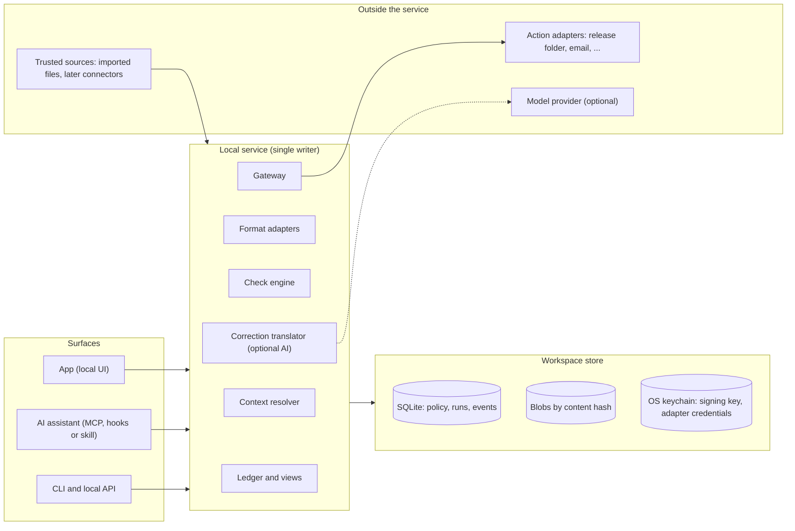
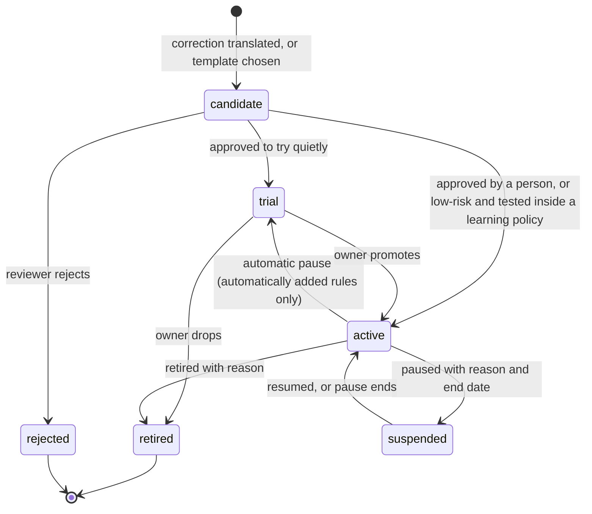
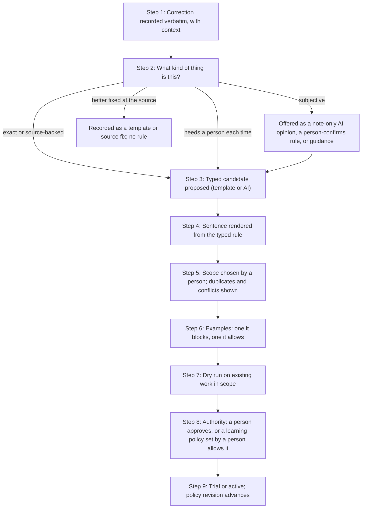

# 03 · Architecture and rule model

> Proposed design. Nothing in this document is implemented. Performance figures are goals to be verified, not measurements.

## 1. Shape of the system



One local service owns one workspace store. Everything else talks to the service. The service is the only writer, which is what makes ordering, receipts and the ledger trustworthy on a single machine.

## 2. Components

| Component | Responsibility | Deliberately does not |
|-----------|----------------|-----------------------|
| **Context resolver** | Turns "this file, this action" into workspace, project, area, work type; selects the rules in scope ([04](04-context-and-scope.md)) | Use session memory or similarity search |
| **Format adapters** | Identify the real file type; produce a normalized, typed artifact with provenance and a coverage report ([05](05-formats.md)) | Execute macros, fetch remote content, guess silently |
| **Check engine** | Pure function from (artifact, action, context, rule revisions, source snapshots, exceptions, clock) to results | Modify artifacts, call the network, read the wall clock |
| **Correction translator** | Proposes a typed candidate rule from a person's words, using templates and optionally an AI model | Activate anything, set scope or enforcement without a person |
| **Gateway** | Holds the ability to perform registered actions; verifies receipt, approval and bindings before executing ([06](06-enforcement-and-integration.md)) | Treat a passing check as permission |
| **Ledger and views** | Appends events; maintains the read models behind every screen ([02](02-observability.md)) | Allow updates or deletes of envelopes |
| **Surfaces** | App for people; MCP tools, hooks and a skill for assistants; CLI and local API for integrators | Hold credentials for gated actions |
| **Capture intake** | Receives events from opted-in capture adapters; acknowledges, de-duplicates, orders, detects gaps, binds each event to a project, enforces consent ([06 §11](06-enforcement-and-integration.md#11-capture-adapters)) | Decide what an event means; keep text it has no consent for |
| **Signal detector** | Identifies learning signals among captured events by fixed trigger conditions; groups them into episodes ([12 §5](12-learning.md#5-what-counts-as-a-signal)) | Treat document, email or tool text as a signal |
| **Learning decision** | A pure function from (signals, candidate, evaluation, learning policy) to an outcome; activates a low-risk, tested rule only inside a learning policy a person set ([12 §7](12-learning.md#7-the-decision)) | Use model confidence; weaken, pause or retire anything a person approved; act on artifacts |

The check engine being a pure function is a load-bearing decision: it is what makes "re-run as recorded" possible and what lets regression examples act as real tests.

## 3. The workspace store

**One workspace = one store = one isolation boundary.** A workspace belongs to a person or a team (an "organization" in a small company is simply a workspace). Different workspaces share nothing: separate files, separate keys.

| Part | Contents | Notes |
|------|----------|-------|
| `workspace.db` (SQLite, WAL mode) | Policy tables, run records, the event ledger, read models | Lives in the operating system's per-user application-data directory (or on the workspace host in team mode), **not** inside project folders |
| `blobs/` | Artifact snapshots, normalized artifacts, source snapshots, example files, diffs; each addressed by SHA-256 | Deduplicated; subject to retention |
| OS keychain entries | Workspace signing key (receipts, ledger anchors), action-adapter credentials | Never in the database, never visible to assistants |
| Folder marker (in each registered folder) | A small file naming the workspace, project and binding; **an identifier, not policy** | Described in [04 §3](04-context-and-scope.md#3-registering-folders) |

Why not keep the store in the project folder, where it would "travel with the work"? Because project folders are routinely synced, copied, zipped and shared. A live SQLite file in a sync folder is a corruption risk; a policy store that can be copied with a folder is a store that can be forked or swapped by anyone with the folder. Policy lives with the workspace; the folder only carries a pointer. See [ADR-001](09-decisions.md#adr-001--a-per-workspace-sqlite-store-outside-project-folders-with-no-git-dependency).

Table groups (logical; exact DDL is implementation work):

| Group | Tables |
|-------|--------|
| Identity | `workspace`, `principals`, `role_grants`, `projects`, `project_facts`, `folder_bindings`, `areas`, `work_types`, `field_mappings` |
| Policy | `corrections`, `rules`, `rule_revisions`, `rule_scope_index`, `cases`, `exceptions`, `policy_revisions` |
| Sources | `sources`, `source_snapshots`, `source_rows` (indexed lookup copy of each snapshot) |
| Work | `artifacts`, `artifact_versions`, `runs`, `check_results`, `findings`, `fix_proposals`, `changes`, `attestations`, `feedback` |
| Gate | `receipts`, `action_requests`, `approvals`, `executions`, `adapters` |
| Ledger | `events`, `event_payloads`, `anchors` |
| Capture and learning | `learning_policies`, `capture_streams`, `capture_events`, `capture_dead_letters`, `signals`, `episodes`, `learning_decisions`, `inbox_items`, `suppressions` |

Properties:

- **Immutable revisions.** `rule_revisions`, `source_snapshots`, `artifact_versions`, `runs` and `events` are insert-only. "Editing a rule" inserts a revision. Database triggers reject updates and deletes on these tables as defence in depth; real tamper evidence comes from the hash chain ([07 §7](07-security-and-governance.md#7-ledger-integrity-backup-export-and-import)).
- **Policy revision.** `policy_revisions` is a workspace-wide counter incremented by anything that can change which rules apply or how: activating, revising, pausing, resuming or retiring a rule; granting or ending an exception; changing project facts used in scopes; confirming a field mapping. Every run and event records the `policy_rev` in force.
- **No Git.** History, diff and blame for rules are built into the store and shown in the app. Export and import of signed policy bundles covers sharing ([07 §7](07-security-and-governance.md#7-ledger-integrity-backup-export-and-import)).

## 4. The rule model

### 4.1 Anatomy of a rule revision

Proposed shape: [rule.schema.json](../schemas/rule.schema.json). Example: [rule-current-price.json](../examples/sales-proposal/rule-current-price.json). The stored revision content never changes. The shape shown to clients adds a few lifecycle fields (`status`, `approval`, each example's `last_result`) that are computed from ledger events.

| Part | Fields | Purpose |
|------|--------|---------|
| Identity | `rule_id`, `revision`, `status`, `supersedes` | Stable id; integer revision; lifecycle state |
| Words | `title`, `statement`, `message.problem`, `message.fix_hint` | All rendered from templates and typed fields; shown to people |
| Origin | `origin.kind` (`human_correction`, `starter_pack`, `imported_pack`), `origin.correction_id` | Every rule can be traced to why it exists |
| Ownership | `owner`, `review_by` | A named person; a date by which someone must look again |
| Scope | `scope.level`, ids, `project_selector`, `work_types`, `artifact_types`, `actions` | Indexed, context-decidable applicability ([04 §5](04-context-and-scope.md#5-which-rules-apply-deterministic-scope-matching)) |
| Content condition | `applies_when` | Optional typed predicate on artifact or action fields, evaluated after parsing |
| Requirement | `check.kind`, `check.targets`, `check.params` | One entry from the closed catalogue (§5) |
| Needs | `requires.fields`, `requires.components` | What must be readable for the rule to be decidable |
| Source | `source.source_id`, `max_age_days`, `require_latest`, `missing_key` | Only for source-backed rules |
| Assurance | `method` | How the answer is known (§4.2) |
| Consequence | `enforcement`, `locked` | What a failure does; whether narrower scopes may be exempted without the owner |
| Tests | `cases[]` | Stored examples with expected outcomes |
| Exceptions | `exception_policy` | Who may grant one and for how long |
| Authority | `authority.kind` (`individual_approval` or `delegated_learning`), `authority.zero_click`, the learning policy and decision for delegated rules; `approval.approved_by`, `approved_at`, `activated_at` for individually approved ones | On whose authority the rule is in force |

### 4.2 Three separate axes

The working hypothesis listed "hard / warn / unknown / manual" as one set of states. Those are three different things, and mixing them hides important combinations (a manual rule that blocks; a deterministic rule that only notes). The design separates them:

| Axis | Values | Question it answers |
|------|--------|---------------------|
| **Method** (per rule) | `deterministic`, `source_backed`, `attested`, `model_review` | How do we know? |
| **Enforcement** (per rule) | `block`, `warn` | What happens when it is not met? (`warn` is shown as a "note") |
| **Outcome** (per rule per run) | `pass`, `fail`, `unknown`, `error`, `not_applicable`, `waived`, `conflict`, `skipped` | What happened this time? |

Constraints between the axes:

- `model_review` rules can only be `warn`. An AI opinion never blocks and never satisfies a must-pass requirement. A model's *concern* may be routed to a person by pairing it with an `attested` rule; the model's *approval* counts for nothing.
- `attested` rules produce `unknown` (reason: awaiting confirmation) until a person with the named role confirms for that exact artifact version; then `pass` with the attestation recorded. A person can also record "not acceptable", which is `fail`.
- A rule in `trial` status is evaluated normally but its effective enforcement is capped at `warn`.
- `skipped` is permitted only for `warn` rules.

### 4.3 Lifecycle



- **Revising** an active rule creates a new candidate revision that goes through the same approval; on activation the new revision's `supersedes` field names the previous one, which is no longer evaluated. Runs keep pointing at the revision they used.
- **Suspension always has an end date.** A paused rule that nobody resumes comes back by itself, with an event.
- **Automatic pause** exists only for rules that were added automatically under a learning policy and never confirmed by a person: a direct contradiction, repeated disputes, a failing example or a conflict with an approved rule moves such a rule from `active` to `trial` (shadow), with an event and a question to a person ([12 §9](12-learning.md#9-after-a-rule-is-learned)). No other rule can be demoted without a person.
- **Retirement is never automatic.** Dormant or overdue rules are queued for their owner; only a person retires a rule.
- Every transition is an event with actor, approver and reason ([02 §4.2](02-observability.md#42-event-catalogue)).

## 5. The check catalogue

Rules are data. A rule's requirement is one entry from a closed catalogue of check kinds with typed parameters. There is no scripting, no embedded expression language beyond the small predicate grammar below, and no way for a rule to call code. See [ADR-003](09-decisions.md#adr-003--a-closed-catalogue-of-typed-checks-no-scripts).

| Kind | Decides | Method | Example sentence | MVP |
|------|---------|--------|------------------|-----|
| `field_present` | A field has a value | deterministic | "The quote has a validity date" | Yes |
| `field_in_set` | A field's value is one of an allowed set (a set of one is "equals") | deterministic | "Every line, and the total, is in SGD" | Yes |
| `fields_agree` | Two fields, or a field and a project fact, are equal after normalization | deterministic | "The customer named in the document matches the project" | Yes |
| `number_compare` | A number compared with a constant or another field | deterministic | "Discount is at most 15%" | Yes |
| `date_window` | A date relative to the check time or another date | deterministic | "Validity date is at least 30 days ahead" | Yes |
| `arithmetic_consistency` | Row products and column sums hold within a tolerance | deterministic | "Line totals and the grand total add up" | Yes |
| `section_present` | A heading or named section exists (optionally non-empty) | deterministic | "Large quotes include a Credit terms section" | Yes |
| `text_contains` | A phrase or restricted pattern must, or must not, appear within a part of the document | deterministic | "The standard liability paragraph appears unchanged"; "The word 'guarantee' does not appear" | Yes |
| `no_unresolved_markup` | No comments, tracked changes, highlighted placeholders such as "[TBD]" | deterministic | "No unresolved comments or tracked changes" | Yes |
| `field_matches_source` | A field equals the value looked up in a trusted source snapshot | source_backed | "Unit prices match the current price list" | Yes |
| `attestation` | A person with a named role confirms a statement for this exact version | attested | "A solutions engineer has reviewed the scope section" | Yes (basic) |
| `no_hidden_content` | No hidden sheets, rows, columns or hidden text in a named region | deterministic | "The payment sheet has no hidden rows" | With spreadsheets |
| `rows_unique` | No duplicate rows by key columns | deterministic | "No payee appears twice" | With spreadsheets |
| `value_is_formula` | A value is computed by a formula over a stated range, not typed in | deterministic | "The batch total is a formula over all payment rows" | With spreadsheets |
| `model_review` | An AI model's opinion on a stated criterion | model_review | "The summary reads as written for a non-specialist" | Later; note only |

Targets address three namespaces: semantic fields of the artifact (`quote.line_items[*].unit_price`), the action envelope (`action.params.to_domain`), and context (`context.project.facts.customer_id`). Because action parameters are addressable, "only send to the customer's own email domain" is an ordinary `field_in_set` rule evaluated at the gate.

**Predicate grammar** (for `applies_when`): a tree of `all`, `any`, `not` over leaves of the form `{field, op, value}` with `op` in `eq`, `ne`, `in`, `not_in`, `lt`, `le`, `gt`, `ge`, `exists`. Nothing else. If a field the predicate needs cannot be read, the predicate is *undecidable* and the rule's outcome is `unknown`, not `not_applicable`.

**Patterns** (for `text_contains`): literal phrases by default. Where a pattern is needed, only a restricted syntax with guaranteed linear-time matching is accepted (no backreferences, no lookaround, bounded length). Every pattern rule must carry at least one example string it matches and one it does not, shown to the approver, because patterns are the place where rules most often mean something other than intended.

**Adding a check kind** is a product release, with its own documentation, sentence templates and tests. It is deliberately not a user-level extension point.

## 6. From correction to active rule

The working hypothesis put human approval before regression cases. The design reverses that: the examples and a dry run on existing work come first, and they are what the authority decision rests on. That decision is made either by a person looking at them (described here), or, where a person has set a learning policy for the project, by a deterministic procedure applied to the same evidence ([Learning](12-learning.md)). The steps are the same in both cases; only step 8 differs.



Step notes:

1. **Correction recorded.** The person's words are stored unchanged, with who, when, and what they were pointing at. If the correction arrives through an assistant, the assistant's session is recorded as the channel and the person as the author; it remains a candidate until that person (or an approver) confirms it in the app.
2. **Kind.** Offered honestly: an exact check, a trusted-source check, a person-confirms rule, an AI opinion (note only), plain guidance, or "fix the template/source instead". The last option matters: when the same error comes from a stale template, the best correction removes the cause, and the product records that as the outcome instead of adding a rule.
3. **Typed candidate.** Either picked from templates by the person, or proposed by the translator. The translator's output must validate against the rule schema and against the workspace's field dictionary and source registry; anything else is discarded. The translator cannot write anywhere except the candidate table.
4. **Rendering.** The sentence the person approves is produced by a fixed template from the typed fields ([ADR-009](09-decisions.md#adr-009--the-sentence-a-person-approves-is-rendered-from-the-typed-rule)). An AI-written paraphrase is never the thing approved.
5. **Scope.** The narrowest scope that covers the context is preselected. Wider scopes name the approver they need. Structural duplicates and unsatisfiable combinations are computed here (§10.3, §10.5).
6. **Examples.** The artifact the correction was about becomes the "should be caught" example automatically. A must-pass rule needs at least one "should pass" example as well. Examples are stored as files plus pinned source snapshots, so they are hermetic.
7. **Dry run.** The candidate is evaluated against existing artifact versions in its would-be scope. The result ("3 of 9 would need changes", with the list) is shown and recorded. Nothing is blocked retroactively.
8. **Authority.** Either *individual approval* by a person holding the steward role for the chosen scope (approver and proposer may be the same person in small setups; the record shows it), or *delegated learning*: the candidate is low-risk, has passed its tests on real evidence, and falls inside a learning policy that such a person saved earlier for this project ([12 §7](12-learning.md#7-the-decision)). Anything broad, consequential, ambiguous or loosening always takes the first route.
9. **Activation.** `trial` or `active`. The policy revision advances; outstanding receipts whose in-scope rule set changed become invalid ([06 §3](06-enforcement-and-integration.md#3-validation-receipts)).

What AI may and may not do in this pipeline:

| May | May not |
|-----|---------|
| Suggest which check kind fits a correction | Activate, approve, widen scope or raise enforcement. Automatic activation is done by the deterministic learning decision, never by a model |
| Raise a concern about a candidate, which blocks automation | Vouch for a candidate: no model output, and no model confidence, can remove a blocker |
| Fill in typed parameters for review | Produce the sentence that is approved |
| Suggest a field mapping for a new document layout | Have its extracted values satisfy a must-pass rule without confirmation ([05 §5](05-formats.md#5-semantic-fields-and-how-they-are-extracted)) |
| Draft an example description | Infer that a correction applies universally |
| Be switched off entirely; templates still work | Read artifact content beyond what the person allowed to be sent to the model |

## 7. Evaluation

```text
run = evaluate(artifact, action, context, rule_revisions, source_snapshots,
               exceptions, attestations, as_of)
```

All inputs are explicit, including the clock (`as_of`). The engine performs no I/O.

Order of work for one check:

1. **Identify and normalize** the artifact ([05](05-formats.md)). Failure here yields a run with verdict *Couldn't verify* and reason "could not be read".
2. **Resolve context** and **select in-scope rules** by index ([04 §4–5](04-context-and-scope.md#4-resolving-context)). If context is ambiguous or unknown, stop and ask, or block if an action is pending.
3. For each in-scope rule, in a stable order:
   1. **Needs.** If a required field or component is missing, unreadable or below confidence, outcome `unknown` with the specific reason.
   2. **Content condition.** False gives `not_applicable` with the deciding value. Undecidable gives `unknown`.
   3. **Requirement.** Evaluate the check kind. Source lookups use only snapshots passed in; freshness is judged against `as_of`.
   4. **Exception.** If an approved, unexpired exception covers this rule in this context, the outcome is `waived`, with the underlying outcome retained.
4. **Conflicts.** Rules statically known to be mutually unsatisfiable in this context are both marked `conflict`.
5. **Effective enforcement** per rule: the rule's `enforcement`, capped at `warn` for trial and `model_review`.
6. **Verdict.**

| Effective enforcement | `fail` | `unknown`, `error`, `conflict` | `pass`, `not_applicable`, `waived` |
|-----------------------|--------|--------------------------------|------------------------------------|
| `block` | **Needs changes** | **Couldn't verify** | no effect |
| `warn` | Note | Note ("a recommended rule could not be verified") | no effect |

   *Needs changes* outranks *Couldn't verify*, which outranks *Ready*. "Unknown never silently passes" holds on both rows: on a `block` rule it stops the action; on a `warn` rule it is displayed.

7. **Fix proposals** are generated for findings where a deterministic suggestion exists (§9).
8. **Receipt.** If the verdict is *Ready* and the action is one a gateway handles, a receipt is issued ([06 §3](06-enforcement-and-integration.md#3-validation-receipts)).

A check never ends early. If evaluation of a rule exceeds its time budget or throws, that rule's outcome is `error`; the others still run; the verdict cannot be *Ready*.

## 8. Trusted sources

A source-backed rule is only as good as the list behind it, so sources are first-class objects with an owner and an age.

| Concept | Definition |
|---------|------------|
| **Source** | A named reference list (e.g. "Halden price list") with an owner who vouches for it, a declared key (e.g. item code + currency) and value columns |
| **Snapshot** | One immutable imported version: content hash, who imported it, when, optional "effective from" date, row count. Lookups read snapshots, never live files |
| **Freshness policy** | `max_age_days` since the snapshot was imported or last re-confirmed by the owner; `require_latest` (a newer snapshot supersedes older ones) |
| **Lookup result** | Exactly one row: compare. No row: `unknown` by default ("item not in the price list"), or `fail` if the rule says items must be listed. Several rows: `unknown` ("ambiguous key") |

Rules:

- **Authority is a human designation.** A file becomes a trusted source when a named person says so in the app. The product does not infer authority from a file's location or name.
- **Stale is unknown.** When a snapshot is older than its window, rules that read it return `unknown` (reason: source out of date). The owner is prompted to import a new version or re-confirm the current one; both are events.
- **A new snapshot invalidates dependent receipts** and triggers automatic rechecks for work with a pending action. Other work shows "source changed since last check".
- **MVP sources are imported files** (spreadsheet or CSV). Live connectors come later and must still materialize immutable snapshots, so that every result names the exact data it used.

Proposed shape: [source-snapshot.schema.json](../schemas/source-snapshot.schema.json).

## 9. Findings, fix proposals and changes

| Object | Created by | Contains |
|--------|-----------|----------|
| **Finding** | The engine | Rule and revision, location (machine locator plus human label), what was found, what was expected, evidence (e.g. the source row used), the rule's message |
| **Fix proposal** | The engine when the expected value is known; an assistant or a person otherwise | One or more proposed edits (`set_value`, `remove`, `insert_text`) or a plain instruction; the findings it addresses; where the proposed values came from |
| **Change** | Observed by the service when a new version of an artifact appears | Version before and after, a structural diff, who or what produced the new version (if known), the fix proposal it applied (if any) |

Rules of the repair model:

- **The engine never edits artifacts.** In the MVP no component of the product writes to a user's work file. A person or their assistant makes the edit in the tool they already use; the product notices the new version.
- **Attribution is explicit or "unknown".** A version that merely appears while a session is open is described as "first seen during that session", which is a statement about timing, not authorship. If the new version arrives through a connected session ("I saved version 2 applying fix F"), the change is attributed to that session's agent on behalf of its user. If the file simply changed on disk, the change is attributed to "unknown editor". The product does not guess.
- **A change is linked to a fix proposal** only if the session declares it or the diff matches the proposed edits exactly.
- **Recheck is automatic** when a new version appears for an artifact with open findings or a pending action. The recheck is a new run with its own identity; resolved findings are computed by comparing runs ([02 §5.5](02-observability.md#55-obs-5--beforeafter-compare)).
- **Later (not MVP): "apply for me"** for simple value replacements, performed on a copy, shown as a diff, and written only on the person's explicit confirmation, attributed to that person.

## 10. Keeping a growing rule set enforceable

The concern: the list of rules only grows; a long list must not lead to rules being silently dropped, to slow checks, or to a list nobody can understand.

### 10.1 Selection is a lookup, not a search

Every active rule revision is expanded into rows of `rule_scope_index`, keyed by the context dimensions (workspace; project or project-group membership; area; work type; artifact type; action), each either a specific value or "any". Selecting the rules for a context is one indexed query with an exact-or-any match on each dimension ([04 §5](04-context-and-scope.md#5-which-rules-apply-deterministic-scope-matching)). The result is the complete set. There is no ranking, no top-k, no embedding, no model in this path.

### 10.2 Every in-scope rule is evaluated

There is no evaluation budget that trims the set. If a check cannot finish a rule, that rule is `error` and the verdict reflects it (§7). A run records the count of active rules in the workspace, the count in scope, and a digest of the in-scope set, so completeness can be audited after the fact.

### 10.3 Fewer rules without less coverage

Growth is managed by structure, not by forgetting:

- **Duplicate detection at creation.** Two rules with the same check kind and target and overlapping scope are structural near-duplicates. The proposer is offered "add to the existing rule" (for instance, extend an allowed set) before a new rule is created.
- **Families become tables.** When several rules differ only in a value keyed by a fact ("Meridian quotes in SGD", "Northshore quotes in USD", …), the product suggests one rule ("quote currency equals the customer's contract currency") backed by a small trusted source (customer → currency) with an owner. Forty rules become one rule and forty rows; coverage is unchanged, and adding a customer becomes a data change with its own history. The suggestion appears at a configurable family size (default 5).
- **Review dates and a health queue.** Every rule has a `review_by`. Overdue, dormant, conflicting and failing-example rules are queued for their owners ([02 §5.1](02-observability.md#51-obs-1--rules-overview)).
- **Retirement is explicit and recorded**, never automatic.

### 10.4 Staying understandable

Rules are grouped by where they apply and by topic (derived from the target field: *price*, *currency*, *dates*, *structure*). Each has one owner. "View as project" shows precisely what applies to a given project. Scope breadth is visible on every rule ("4 projects, 9 documents today").

### 10.5 Conflicts

Because rules combine by conjunction ([04 §6](04-context-and-scope.md#6-how-rules-combine)), a local rule can never loosen a wider one; the only failure mode is two rules that cannot both be met. For rule pairs with the same target and comparable kinds (allowed sets, numeric bounds, date windows, present/absent, must/must-not contain the same phrase), satisfiability is decidable by simple typed comparison. This is computed:

- when a candidate is proposed (shown in UX-7b),
- when a policy bundle is imported,
- when project facts change which rules meet in a project.

Pairs the analysis cannot compare are not flagged statically; if both fail on the same location with incompatible expectations at run time, the run marks them `conflict`. Conflicts are never resolved by precedence.

### 10.6 Cost model and performance goals

Work per check is: one parse and normalization; one index query; one pass per in-scope rule over the fields it targets (fields are indexed by path, so a rule touches only its targets); one indexed lookup per source key. Cost grows with the number of rules *in scope*, not with the size of the workspace's rule list.

**Goals, to be verified by a benchmark suite during the MVP. None of these has been measured.**

| Operation | Goal (p95, on a mainstream laptop to be specified) | Stress condition |
|-----------|---------------------------------------------------|------------------|
| Resolve context and select rules | ≤ 50 ms | 10,000 active rules, 500 projects |
| Evaluate in-scope rules on a normalized artifact | ≤ 1 s | 200 rules in scope, 50-page proposal |
| Identify, parse and normalize a document | ≤ 3 s | 50-page DOCX with 20 tables |
| Gateway revalidation (no re-parse) | ≤ 200 ms | — |
| Rules overview, filtered | ≤ 300 ms to first rows | 10,000 rules |
| Timeline for one trace | ≤ 300 ms | 500 events |
| Static conflict analysis for one candidate | ≤ 500 ms | 10,000 active rules |

If a goal is missed, the fallback is to be slower, never to evaluate fewer rules.

### 10.7 What an assistant is told is a separate matter

A long rule list also strains what can be put in an assistant's context. That is handled by the session brief, which may summarize ([04 §9](04-context-and-scope.md#9-the-brief-is-advisory-the-check-is-complete)). Enforcement does not depend on the brief.

## 11. Versioning and drift

| Thing | Version marker | When it changes |
|-------|----------------|-----------------|
| Stored shapes | `schema_version` on every record (`cl.rule/1`, `cl.artifact/1`, `cl.run/1`, …) | Migrations are additive within a major version |
| Check engine | `engine_version` on every run and receipt | Any change to evaluation semantics |
| Format adapters | `parser.id`, `parser.version` on every normalized artifact, run and receipt | Any change to parsing or field extraction |
| Rules | `revision` | Any edit |
| Policy | `policy_rev` | Any change to what applies (§3) |

**Upgrades are tested against the rule examples before they take effect.** When the engine or a format adapter is updated, every stored example for every active rule is re-run with the new version. If any example's outcome changes, the affected rules are placed in the health queue and the previous version continues to be used for gated checks until an owner has reviewed the difference. Outstanding receipts are bound to the versions that produced them and are invalidated by an upgrade. The examples people record when approving rules therefore double as the regression suite that guards against parser drift.

**Old records are never rewritten.** Events, runs and receipts stay in the schema version they were written in, and the software keeps readers for every earlier major version, so a timeline from last year still opens after an upgrade. Nothing is migrated in place; receipts from an older version simply lapse and are re-issued by a fresh check.
