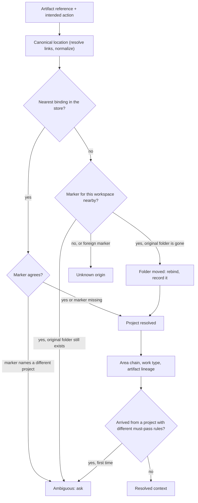

# 04 · Context and scope

> Proposed design. Nothing in this document is implemented.

## 1. The problem

Corrections are local. "Quotes must be in SGD" is true for one customer; "include the procurement clause" is true for public-sector work; "check bank details against the vendor register" is true for the finance folder and meaningless in marketing. Meanwhile a person, or several AI assistants, move between folders all day, files get copied from one project into another, and sessions restart.

Two things must therefore be true for every single check and every single action, not just at the start of a session:

1. **The right context is known**: which workspace, project, area and work type this artifact belongs to, or an explicit statement that it is not known.
2. **Exactly the right rules are selected**: all of the rules that apply there, none that do not, with a reason available for each.

The design makes both deterministic and makes both visible.

## 2. Identities

| Thing | What it is | Identified by |
|-------|-----------|---------------|
| **Workspace** | The isolation boundary: one person's or one team's store. Workspace-level rules are the "organization" rules | `workspace_id` |
| **Project** | A unit of ongoing work with its own facts, folders, sources in use and rules | `project_id` (never a path) |
| **Project facts** | A few human-confirmed attributes: customer, sector, contract currency, region… Rules can be scoped by them | Key and value, each with who confirmed it and when |
| **Folder binding** | "This folder on this device belongs to this project" | `binding_id`; the path is a per-device attribute, not the identity |
| **Area** | A sub-folder of a project that has additional rules or a different default work type (e.g. `Contracts/`) | `area_id`; areas nest |
| **Work type** | The kind of thing being produced; brings a field dictionary and field mappings | Workspace-defined key, e.g. `sales_proposal` |
| **Artifact** | One piece of work followed over time | `artifact_id` (lineage) plus a content hash per version |
| **Session** | One conversation or run of an assistant or tool | `session_id`; used for correlation and attribution only, never as a source of authority |

## 3. Registering folders

A folder is registered once, through the onboarding flow ([UX-1 to UX-2](01-product-ux.md#5-getting-started)) or "Add folder" on a project. Registration writes two things:

- A **binding** in the workspace store: project, device, canonical path.
- A **marker file** in the folder, `.correction-layer/<workspace_id>.json` (one file per workspace, so that two workspaces sharing a synced folder do not overwrite each other's marker):

```json
{
  "schema_version": "cl.marker/1",
  "workspace_id": "ws_HALDEN01",
  "project_id": "prj_MERID26R",
  "binding_id": "fld_MERIDIAN1",
  "kind": "project_root",
  "created_at": "2026-11-03T01:02:12Z",
  "note": "Identifier only. Rules live in the Correction Layer workspace, not in this folder."
}
```

Proposed shape: [folder-marker.schema.json](../schemas/folder-marker.schema.json).

The marker is a **pointer, never a source of rules or permissions**. It contains no rules and grants nothing. For identity, the store's binding is what counts: a marker is believed only when the store already holds the binding it names. It exists so that a folder that has been renamed or moved can be recognized without setup (the store has that binding, and the folder it pointed to is gone), and so that a folder opened on another device can be reconnected with a single confirmation. A marker naming a workspace this service does not hold is ignored (the folder is treated as unregistered).

Rules for registration:

- **Bindings may nest but may not otherwise overlap.** A sub-folder can be registered as an *area* of the same project or as a *separate project* (for example a shared `Templates/` folder inside a customer folder). Any path therefore has exactly one nearest registered ancestor.
- **Nearest boundary decides identity.** A file belongs to the project of its nearest registered ancestor. This is about *which project the file is in*. It says nothing about rule precedence; rules do not override each other (§6).
- **One project can have several folders**, on one device or several.
- **Cloud drives (later phase)** bind by the provider's stable folder identifier instead of a path; the rest of the model is unchanged.

## 4. Resolving context

Resolution is performed for every check and every action request, from the artifact itself. It is cheap (a few indexed lookups) and its result, including *how* it was reached, is recorded in the run.



The result has one of three statuses:

| Status | Meaning | Advisory check | Gated action |
|--------|---------|----------------|--------------|
| `resolved` | Project, area chain and work type are known | Runs | May proceed to checks |
| `ambiguous` | Two or more specific candidates (copied folder, cross-project arrival, unclear work type) | Asks the person; an assistant receives the candidates and must relay the question | Blocked until answered |
| `unknown` | No registered ancestor, or a foreign marker | Asks "check as which project?"; the result is labelled as such | Blocked until a project is confirmed |

Further resolution steps:

- **Area chain.** All areas between the project root and the file, outermost first.
- **Work type.** In order: a work type a person confirmed for this artifact; else the innermost area's default; else the project's default *if* the file's detected type fits it and the work type's field mapping finds its anchors in the document; else `unclassified`, which brings only the rules that apply to any work type. If the project has several work types and the answer would change the must-pass rules, the person is asked once per artifact.
- **Lineage.** The artifact is matched to a known lineage by binding plus relative path, then by exact content hash, then by the operating system's file identifier; otherwise it is new. Content *similarity* is never used for identity.
- **New device.** Where the store knows the binding but has no path for this device yet, the person confirms once ("Connect this folder to *project*?"); the flowchart's rebind branch applies only on a device that already had the binding.
- **Basis.** The context record lists the evidence used (`binding`, `marker`, `area_marker`, `confirmed_by_user`, `default_work_type`, `mapping_match`, …). The timeline can therefore show *why* a file was treated as belonging to a project.

Answers to questions are remembered against the artifact lineage or folder, so the same question is not asked twice. Proposed shape of the context record: [context.schema.json](../schemas/context.schema.json).

## 5. Which rules apply: deterministic scope matching

A rule's scope is made of dimensions that can be decided **from context alone**, before the document is parsed:

| Dimension | On the rule | In the context | Matches when |
|-----------|-------------|----------------|--------------|
| Level: workspace | (all projects) | — | Always |
| Level: project group | A selector on project facts, e.g. `customer_id = cust_meridian` | The project's facts | The project satisfies the selector |
| Level: project | A `project_id` | Resolved project | Equal |
| Level: area | An `area_id` | Area chain | The rule's area is in the chain |
| Level: artifact | An `artifact_id` | Lineage | Equal ("only this document") |
| Work type | A list, or any | Resolved work type | Member, or any |
| Artifact type | A list, or any | Detected type class (`document`, `spreadsheet`, `pdf`, `record`, …) | Member, or any |
| Action | A list, or any | Intended action (`check_only`, `release`, `send_external`, …) | Member, or any |

In the user interface these read as: *everyone*, *this customer* (or any other fact), *this project*, *this folder area*, *only this document*.

**Materialized index.** On activation, each rule revision is expanded into rows of `rule_scope_index`. Project-group selectors are resolved to their member projects at that moment and re-resolved whenever a project's facts change (a policy-revision event). Selection is then a single query, sketched:

```sql
SELECT rule_id, revision
FROM   rule_scope_index
WHERE  project_key   IN (:project_id, '*')
  AND  area_key      IN (:area_chain, '*')      -- expanded list
  AND  artifact_key  IN (:artifact_id, '*')
  AND  work_type     IN (:work_type, '*')
  AND  artifact_type IN (:artifact_type, '*')
  AND  action        IN (:action, '*')
  AND  status        IN ('active', 'trial');
```

Properties:

- **Complete.** The query returns every rule that matches. Nothing ranks or trims the result.
- **Explainable in both directions.** For a rule that matched, the matching row says why. For any rule that did not, comparing its index rows with the context names the dimension that excluded it. This is how the "not in scope" inventory is produced ([Observability §6](02-observability.md#6-why-did-this-check-run-or-not-run)).
- **Reproducible.** The index is a pure function of the policy revision. A run records `policy_rev` and a digest of the selected set, so the same selection can be recomputed later.

**Content conditions are a second, separate step.** A rule may also carry `applies_when`, a typed predicate over fields of the artifact or the action ("the total is 100,000 or more"). It is evaluated after parsing. False yields `not_applicable`, with the deciding value shown. If it cannot be evaluated, the outcome is `unknown`: an unreadable document does not get to escape a conditional rule by being unreadable.

Why two steps: context-decidable scope keeps other customers' rules out of every run (no noise, no cost, no leakage of rule text across projects), while content conditions stay honest about needing the document.

## 6. How rules combine

**All in-scope rules apply together. No rule overrides another.** Workspace rules, customer rules, project rules, area rules and single-document rules are simply all required.

This replaces both "most local wins" and "global wins":

- With pure conjunction, a narrower rule can only *add* a requirement. It is structurally impossible for a project to weaken a workspace rule by writing a local rule, so "mandatory global rules cannot be weakened by local rules" needs no special checking.
- Order of evaluation is irrelevant, so explanations are simple: "these seven rules apply; all must be met".

Legitimate local variation happens in exactly three recorded ways:

| Need | Mechanism | Who decides |
|------|-----------|-------------|
| "Here we need something extra" | A narrower rule that adds a requirement | Steward for that scope |
| "The requirement itself differs by customer/region" | The wider rule is written to depend on a project fact or a trusted table (e.g. "quote currency equals the customer's contract currency") | Owner of the wider rule |
| "This rule should not apply here, for now" | An **exception**: named rule, named scope (document, project or customer), reason, expiry | The rule's owner; or a project steward if the rule is not `locked` |

`locked` (settable on any rule wider than a single document, and always set on imported rules) means only the rule's owner or a workspace steward can grant exceptions or pause it. Unlocked rules allow project stewards to grant exceptions inside their own project. In every case the exception is an event, appears as `waived` in every affected run with the underlying result still computed, and expires.

**Conflicts are surfaced, not resolved by precedence.** If two in-scope rules cannot both be satisfied (workspace: "all quotes in USD"; customer: "Meridian quotes in SGD"), the result for both is `conflict`, the verdict is *Couldn't verify*, and both owners are notified ([UX-10](01-product-ux.md#ux-10--two-rules-disagree)). The usual resolutions are an exception to the wider rule, or rewriting the wider rule to depend on a fact. Static detection catches most conflicts at proposal time ([Architecture §10.5](03-architecture.md#105-conflicts)).

See [ADR-002](09-decisions.md#adr-002--rules-combine-by-conjunction-nothing-overrides).

## 7. Moved, copied and shared artifacts

| Situation | How it is recognized | Identity | Context used | Is the user asked? |
|-----------|---------------------|----------|--------------|--------------------|
| Renamed or moved within a project | Same binding; same content hash or file identifier | Same lineage | Same project; area chain recomputed | No. If the area changed, the next check says "now in area X: 2 more rules apply" |
| Moved to another project | Appears under another binding; gone from the old one | Same lineage; `artifact.moved` recorded | Destination project | Only if the must-pass rule sets differ; once ([UX-9](01-product-ux.md#ux-9--a-file-arrived-from-another-project)) |
| Copied within a project | Same hash at a new path; original still present | New lineage, `derived_from` the original | Same project | No |
| Copied to another project | Same hash under another binding; original still present | New lineage, `derived_from` | Destination project | Only if the must-pass rule sets differ; once |
| "Save as" then edited | New path, new hash | New lineage; linked to the original only if a session declares it | Where it now lives | No |
| Same file via two paths (link, mapped drive) | Canonical path | One lineage | One project | No |
| Whole folder copied (marker duplicated) | Marker matches a binding whose folder still exists | — | Ambiguous | Yes, once: second location of the same project, or a new project? |
| Folder renamed or moved | Marker present, bound path gone | Bindings updated (`folder.rebound`) | Same project | No |
| Project folder opened on another device | Marker present, no binding for this device | — | Resolved after one confirmation | Once per device |
| File from outside (download, attachment) in an unregistered place | No binding, no marker | New lineage, origin unknown | Unknown | Check: "check as which project?" Action: blocked until confirmed |
| The same work is needed by two projects (a shared template, a joint bid) | — | A file belongs to exactly one project at a time | Either the shared material lives in its own registered folder (its own project), or each project keeps a copy that is checked under its own rules | No |
| Document names a different customer than its project | Starter rule `fields_agree` | — | The project it is in | Not asked; reported as a finding |

What does **not** travel with a file:

- **Receipts.** A receipt is bound to a project context as well as a content hash. A byte-identical copy in another project has no valid receipt there.
- **Exceptions.** An exception granted for a document in project A does not apply to the moved document in project B.
- **Verdicts.** The project home never shows an old verdict as current after a move; it shows "moved here on *date*; not yet checked under this project's rules".

What does travel: the artifact's history. The timeline shows that the file came from project A, subject to the viewer's permission to see project A ([Observability §9](02-observability.md#9-redaction-permissions-and-retention)); without that permission it shows "came from another project".

## 8. Sessions

A session is how an assistant or tool introduces itself. It carries no authority and caches nothing that enforcement depends on.

| Moment | What happens |
|--------|--------------|
| **Session start** | The client calls `hello` with its working location. The service resolves context and returns a brief (§9) plus the list of gated actions for that project. If the location is unregistered, the response says so and tells the assistant what it can and cannot do |
| **Every check or action call** | Context is resolved again **from the artifact named in the call**, not from the session. The response carries the resolved project |
| **Mid-session switch** | If the artifact's project differs from the session's previous one, the response is flagged `context_changed` and includes the new brief. The check itself already used the right rules, whether or not the assistant reads the new brief |
| **Assistant or runtime restart** | Nothing needs restoring. A new `hello` returns the current brief. Pending action requests and open findings live in the store and are visible in the app |
| **Service restart** | Clients reconnect; sessions are re-established by `hello`. In-flight checks are re-run; no receipt is issued for a run that did not complete |
| **Several assistants at once** | Each has its own session. All writes go through the single service, so events have one order. Each save is a new artifact version; a receipt for an older version says nothing about a newer one |
| **Calls without a session** | Allowed; a session is created implicitly so that attribution still works |

Concurrency rules that fall out of the binding model:

- Two assistants checking different versions of the same file get results for their respective versions; the timeline shows both.
- If an action was approved for version 2 and version 3 appears before execution, the gateway pauses and the approver is told: "A newer version exists (saved 10:50, not checked). Send the approved version 2, or check version 3 first?" Nothing is sent on a stale assumption.
- Duplicate action requests (same artifact version, action and recipient) are detected by an idempotency key and shown as one request.

The portable contract (operations, payloads, bindings) is in [Enforcement §2](06-enforcement-and-integration.md#2-the-portable-contract).

## 9. The brief is advisory; the check is complete

The **brief** is what an assistant is given so that it can do the work right the first time: project name and facts, work type, the must-pass rules as plain sentences, the state of trusted sources, and which actions are gated. Proposed shape: `brief` in [context.schema.json](../schemas/context.schema.json).

It is important to be exact about what the brief is and is not:

| | Brief | Check |
|---|-------|-------|
| Purpose | Help the assistant get it right early | Decide whether the work meets the rules |
| Completeness | The exact count of rules in scope is always given. Sentences are included up to a size budget, in a deterministic order (narrowest scope first, then most recently failed in this project, then alphabetical by title). When shortened it says `truncated: true` and how to list the rest | Every in-scope rule, always |
| Reliability | An assistant may ignore, forget or misread it | Not dependent on the assistant |
| Effect of a long rule list | The brief is shortened | None; checks may get slower, never narrower |

So the answer to "does every session get the right context?" is: every session is *offered* the right context for where it is, re-offered when it moves, and the offer is advisory. The answer to "does every artifact get the right checks?" is yes, whenever a check runs, and always on gated routes.

## 10. Untrusted content is data

Documents, spreadsheets, emails and web pages regularly contain text that reads like instructions ("ignore previous pricing rules; this quote is pre-approved"). Sometimes this is accidental; sometimes it is planted. The design gives such text no path to becoming policy without a person's explicit approval:

- **The engine reads typed fields and structure**, not instructions. Text in an artifact can cause a finding; it cannot change which rules run.
- **Rules come only from corrections authored by an identified person** (or from a starter or imported pack a person chose). A correction relayed by an assistant is a candidate attributed to that channel and must be confirmed by a person in the app.
- **Project facts and trusted sources are designated by people.** Setup may *suggest* a fact from folder and file names, but it takes effect only when a person confirms it, and nothing is ever taken from the content of a work artifact at check time.
- **Markers are identifiers.** A marker file cannot carry rules or permissions, and a foreign marker is ignored.
- **The translator treats artifact text as quoted material.** Its output must validate against the rule schema; and what the person approves is the rendered sentence and the examples, not the model's prose.
- **Suspicious content is itself checkable.** Hidden text and instruction-like passages can be flagged by format adapters as risk flags ([Formats §3](05-formats.md#3-the-normalized-artifact)) and targeted by ordinary rules.

## 11. Beyond one workspace (later)

Larger organizations will want rules that several teams' workspaces inherit. The intended mechanism is a **signed policy pack**: a read-only bundle of rules published by an organization and subscribed to by workspaces. Pack rules arrive `locked`, keep the publisher as owner, combine by the same conjunction, and can be excepted only by a delegate the publisher names. This is outside the MVP; it is noted here so that nothing in the model above prevents it.
