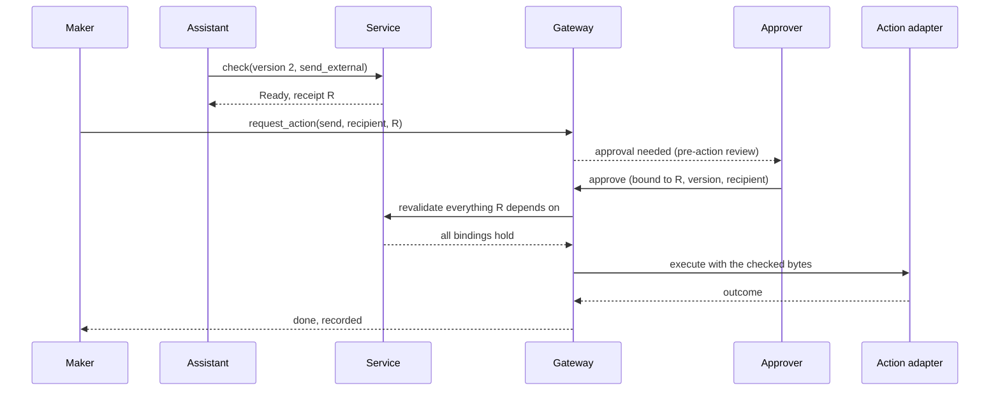

# 06 · Enforcement and integration

> Proposed design. Nothing in this document is implemented. JSON shown here is a proposed contract.

## 1. Three tiers and an honest label

No instruction file, skill or reminder can make an arbitrary AI runtime obey. Enforcement exists only where the product physically sits between the work and the consequence. The design therefore names three integration tiers and never lets a weaker one borrow the vocabulary of a stronger one.

| Tier | Mechanism | What it achieves | What it cannot do |
|------|-----------|------------------|-------------------|
| **Guidance** | A skill or instruction file plus the session brief: "ask Correction Layer before you call work done" | The assistant usually knows the rules and usually checks | Guarantee anything. Instructions can be ignored, truncated or overridden by other text |
| **Checkpoint** | Runtime hooks, where a runtime offers them (session start, before certain tool calls), that call `check` automatically | Checks happen without relying on the assistant's memory | Cover runtimes without hooks; survive a user removing the hook; block what the runtime does not route through hooks |
| **Gateway** | The action can only be performed by an adapter that the gateway controls, because the gateway holds the credential or capability | The action does not happen without a valid receipt and any required approval | Affect any other route to the same outcome |

On screen, each action in a project carries exactly one **coverage label**, generated from what is actually configured ([coverage map](02-observability.md#58-obs-8--coverage-map)):

| Label | Meaning |
|-------|---------|
| **GATED** | A gateway adapter is the registered route. Without Ready and the required approval it will not run. Always shown with a qualifier: *exclusive route* (the adapter holds the only means of doing this), *by convention* (other routes exist; the team has agreed to use this one), or *same-account* (see §6.4) |
| **ADVISORY** | Guidance or checkpoint integration is connected. Checks are offered or triggered; nothing is blocked |
| **OBSERVED** | Registered folders are watched; new versions are noticed and can be auto-checked; nothing is blocked |
| **NOT COVERED** | The product has no view of this route |

Every API response states whether it is advisory or from the gateway (`"enforcement_tier": "advisory"`; guidance and checkpoint integrations are both advisory), and every verdict shown in an assistant's chat is prefixed accordingly ("Advisory check: Needs changes"). See [ADR-005](09-decisions.md#adr-005--three-integration-tiers-with-coverage-labels-generated-from-configuration).

## 2. The portable contract

The contract is small on purpose, so that any assistant, script or application can implement it.

### 2.1 Operations

| Operation | Purpose | Writes |
|-----------|---------|--------|
| `hello` | Introduce a client and its working location; receive context, brief and gated actions | A session |
| `resolve` | Context for one artifact and intended action | Nothing |
| `list_rules` | Every rule sentence in scope for a context (the unshortened brief) | Nothing |
| `check` | Check one artifact version for an intended action; receive verdict, findings, fix proposals and, if Ready and gateable, a receipt id | A run |
| `report_change` | Declare "I produced this new version, applying this fix proposal, for this person" | Attribution on a change |
| `propose_correction` | Pass on a person's correction with its context | A candidate (inactive) |
| `request_action` | Ask the gateway to perform a registered action on a checked version | A request awaiting approval |
| `get_status` | Status of a run, an action request or a pending question | Nothing |

**Minimum handshake:** a client that implements `hello` and `check` is a conforming advisory client. Everything else is optional.

**Deliberately absent:** approving a rule, activating a rule, granting an exception, confirming an attestation and approving an action. These are human acts performed in the app. No assistant-facing operation can perform them, and the service rejects them from client tokens ([§4](#4-approval-is-separate-from-validation)).

### 2.2 Shapes

Session start. Response shape: [context.schema.json](../schemas/context.schema.json); full example: [context.json](../examples/sales-proposal/context.json).

```json
{
  "op": "hello",
  "client": { "name": "example-assistant", "version": "3.2", "runtime": "desktop" },
  "location": { "kind": "path", "value": "/Users/priya/Documents/Proposals/Meridian Clinics" },
  "on_behalf_of": "usr_PRIYA001"
}
```

Check request and abridged response, here for an assistant checking an older quote under today's rules. The full run record behind a response has the shape [run.schema.json](../schemas/run.schema.json); a complete example is [run-1-needs-changes.json](../examples/sales-proposal/run-1-needs-changes.json).

```json
{
  "op": "check",
  "session_id": "ses_PRIYA1112",
  "artifact": { "kind": "path", "value": "/Users/priya/Documents/Proposals/Meridian Clinics/Meridian-Pilot-Quote.docx" },
  "action": { "type": "send_external" }
}
```

```json
{
  "enforcement_tier": "advisory",
  "run_id": "run_PILOT002",
  "context": { "status": "resolved", "project_id": "prj_MERID26R", "work_type": "sales_proposal", "context_changed": false },
  "policy_rev": 10,
  "verdict": "needs_changes",
  "human_summary": "Advisory check: Needs changes. 4 things to fix before this can be sent. 1 note.",
  "counts": { "in_scope": 7, "pass": 3, "fail": 2, "unknown": 0, "not_applicable": 1, "notes": 1 },
  "review_url": "correction-layer://review/run_PILOT002",
  "receipt_id": null
}
```

`human_summary` is rendered by the service and meant to be shown verbatim, so that different assistants describe results the same way.

### 2.3 Bindings

| Binding | For | Notes |
|---------|-----|-------|
| MCP server (stdio) | Assistants that support the Model Context Protocol | One tool per operation |
| Local HTTP on loopback | Applications and browser-based tools | Per-client token issued by a pairing step the user confirms in the app |
| CLI | Hooks, scripts, developers | `correction-layer check <file> --for send_external`; exit status reflects the verdict |
| Skill / instruction file | Guidance tier | Tells an assistant when to call `check`, to show `human_summary` verbatim, to pass on corrections, and to say plainly "Correction Layer is not running; this was not checked" when it gets no answer |

**Pairing.** The first time a client connects, the app asks the user to allow it and for which folders. The client receives a token that identifies it in every session. Client tokens can check and propose; they cannot approve.

### 2.4 Lifecycle of a connected client

1. **Pair** (once): user approves in the app.
2. **Hello** (per session): context and brief for the working location.
3. **Work**: `check` as often as wanted; each call re-resolves context from the artifact ([Context §8](04-context-and-scope.md#8-sessions)).
4. **Pass on corrections**: `propose_correction`; the person reviews in the app.
5. **Request actions**: `request_action`; a person approves in the app; the gateway executes.
6. **Disconnect or crash**: nothing to clean up. State lives in the store.
7. **Revoke**: the user removes the client in the app; its token stops working.

## 3. Validation receipts

A **receipt** is the service's signed statement that one exact artifact version met the rules in scope for one action, at one time, using specific sources. Proposed shape: [receipt.schema.json](../schemas/receipt.schema.json); example: [receipt.json](../examples/sales-proposal/receipt.json).

| Bound to | Field | Why |
|----------|-------|-----|
| The exact bytes | `artifact.artifact_id`, `artifact.content_hash` | A different file, or an edited one, has no receipt |
| The context | `workspace_id`, `project_id`, `area_ids`, `work_type` | A copy in another project has no receipt |
| The action | `action.type`, and `action.params_digest` when any rule read action parameters | Ready-to-release is not ready-to-send-externally |
| The rules | `policy.policy_rev`, `policy.ruleset_digest` (hash over the in-scope rule ids, revisions and applied exceptions) | A rule change in scope invalidates it; unrelated rule changes elsewhere do not |
| The sources | `sources[].snapshot_id`, `fresh_until` | A newer or stale source invalidates it |
| The readers | `parser`, `engine_version` | An upgrade invalidates it |
| Time | `issued_at`, `expires_at` | Default lifetime 24 hours, shortened to the earliest `fresh_until` of any source used |
| Use | `single_use`, `status` (`valid`, `invalidated`, `expired`, `consumed`) | One execution per receipt |
| Meaning | `grants_permission: false` | Stated in the data itself: a receipt is evidence, not authorization |

The receipt is signed with the workspace key. The gateway acts on the **snapshot of the bytes that were checked** (kept in the blob store under the content hash), not on whatever is at the file path at execution time. This closes the check-then-edit gap more firmly than re-hashing a path: what was checked is, literally, what is sent. See [ADR-006](09-decisions.md#adr-006--receipts-bind-everything-the-verdict-depended-on-the-gateway-acts-on-the-checked-bytes).

What invalidates a receipt:

| Change | How it is noticed | What happens |
|--------|-------------------|--------------|
| The file was edited | New version observed; hash differs | Old receipt applies only to the old version. Auto-recheck of the new version if findings were open or an action is pending |
| A newer version exists at execution time | Lineage lookup | Gateway pauses and asks the approver which version is intended |
| A rule in scope was added, revised, paused, resumed or retired; an exception started or ended | `ruleset_digest` for the same context no longer matches | Invalidated; auto-recheck if an action is pending |
| The artifact moved to another project, or project facts changed | Context re-resolved | Invalidated |
| A source used has a newer snapshot or is past its freshness window | Source registry | Invalidated; auto-recheck if an action is pending |
| Parser or engine upgraded | Versions differ | Invalidated |
| Time ran out | `expires_at` | Expired |
| Already used | `status = consumed` | A second execution is refused |

## 4. Approval is separate from validation

Validation answers "does this meet the rules?". Approval answers "should this happen?". They are different questions, asked of different parties, recorded as different events.

- **Who approves** is configured per action and project: a named role, the requester themselves (small setups), or "no approval required" for low-risk actions such as an internal release. The last is a standing pre-authorization: a decision by the workspace owner, recorded with their name and date, shown on every execution it covers, and revocable. A passing check never *becomes* an approval; where none is required, that is because a person decided so in advance.
- **What the approver sees** is the pre-action review ([UX-8](01-product-ux.md#ux-8--pre-action-review-the-approvers-view)): the exact version, action, recipient, every rule applied with its result, exceptions in force, unread parts, and what changed since the first check.
- **What an approval is bound to**: the receipt id, the content hash, the action type and the digest of the action parameters. It expires with the receipt. If the receipt is replaced (for example after a source update), the approval does not carry over by default; the approver is asked again with "what is different" highlighted ([Open questions Q4](10-open-questions.md)).
- **Where approval happens**: in the app, by an authenticated person. Assistant-facing operations cannot approve, and approval prompts are never rendered inside an assistant's conversation where injected text could imitate them.
- **Rule approval is a different permission** from action approval. Being allowed to send does not allow changing what is checked, and vice versa.

Proposed shape for requests and approvals: [action-request.schema.json](../schemas/action-request.schema.json); example: [action-request.json](../examples/sales-proposal/action-request.json).

## 5. What the gateway does at execution time



The gateway's checks, in order. Each failure produces an `action.blocked` event naming the item:

1. The request is well formed and the adapter is enabled for this project.
2. Context resolves, and to the same project as the receipt.
3. The receipt exists, its signature verifies, its status is `valid`, it has not expired.
4. The snapshot bytes hash to the receipt's `content_hash`.
5. No newer version of the artifact exists. Otherwise the request moves to `paused_newer_version`, an `action.paused` event is recorded, and the approver is asked which version is intended.
6. The in-scope rule set for this context still has the receipt's `ruleset_digest`.
7. Every source snapshot used is still the latest and still fresh.
8. Parser and engine versions are unchanged.
9. The required approval exists, from a permitted person, bound to this receipt and these parameters, unexpired; or the recorded policy says none is required.
10. Mark the request `executing`, hand the snapshot bytes and parameters to the adapter, record its outcome, mark the receipt `consumed`.

Where a failure at steps 6 to 8 can be cured by a fresh check, the gateway triggers one automatically; a new receipt then needs a new approval. The gateway never substitutes its own judgment for a missing binding.

**At most once.** For actions that cannot be undone, the request is marked `executing` before the adapter is called. If the service stops before an outcome is recorded, the request becomes `outcome_unknown` and is shown to a person; it is never retried automatically.

## 6. Action adapters

An action adapter is the root of a gated route: the single component able to perform a kind of action.

### 6.1 Lifecycle

| Stage | Who | What |
|-------|-----|------|
| Install | Product release | The adapter ships with a capability declaration |
| Configure | Workspace owner, in the app | Provide what the adapter needs (a folder; a mailbox sign-in). Credentials go to the operating system keychain under the service's identity |
| Enable per project | Workspace owner | Choose which projects may use it and the approval policy for each |
| Health check | Service | A dry run confirms the adapter can reach its target without performing the action |
| Execute | Gateway only | After the checks in §5 |
| Disable or revoke | Workspace owner | Immediate; pending requests are blocked with a reason |

### 6.2 Capability declaration (proposed)

```json
{
  "adapter_id": "adp_EMAIL001",
  "kind": "email_send",
  "action_types": ["send_external"],
  "params": {
    "to": "list of email addresses (required)",
    "cc": "list of email addresses",
    "subject": "text (required)",
    "body_text": "text",
    "attach_as": "original"
  },
  "reversible": false,
  "supports_dry_run": true,
  "credential": { "kind": "mailbox_sign_in", "held_by": "gateway", "visible_to_clients": false },
  "outcome_fields": ["provider_message_id", "accepted_at"]
}
```

### 6.3 First adapters

| Adapter | Phase | How it gates | Honest limits |
|---------|-------|--------------|---------------|
| **Release folder** | 1 (MVP) | Copies the checked bytes into a designated "Released" folder with a release record (content hash, receipt, approval, time). The app can verify any file against its record | No credential is involved; anyone can still copy a draft elsewhere by hand. The gate is real only for teams that adopt "we send only what is in Released", and the release record makes departures detectable, not impossible. Labelled *GATED, by convention* |
| **Email send** | 2 | The gateway holds the sign-in for a sending mailbox and sends the checked bytes as the attachment | Exclusive only if that mailbox cannot be used any other way. Recommended: a dedicated sending identity (e.g. a shared quotes address) whose sign-in exists only in the gateway |
| **Others** (document portals, CRM updates, payment file export) | 3 | Same pattern | Each needs a credible exclusive route to be labelled *GATED, exclusive route* |

### 6.4 Credential isolation, where warranted

- The release folder needs no secret; isolation is not relevant.
- Network adapters keep credentials in the OS keychain, readable by the service process only, never returned by any API and never present in an assistant's context.
- **Single-user caveat.** On one laptop where an assistant runs with the same operating-system account as the service and has shell or file access, the operating system does not separate them strongly. The design does not pretend otherwise: in that setup the coverage label for network adapters reads "GATED, same-account (an assistant with full computer access could bypass)". Real isolation needs the service under a separate account or on a separate machine, which is what team mode provides ([MVP §2](08-mvp-and-acceptance.md#2-phases)).

## 7. Exceptions and confirmations at the gate

- **Exception.** Requested from a review screen, decided by the rule's owner (or a project steward for unlocked rules), with a reason, a scope (this document, this project, this customer) and an expiry. Granting one advances the policy revision, triggers a recheck, and the rule then reports `waived` with its underlying result still shown. The receipt lists the exception ids used; the approver sees them.
- **Confirmation (attestation).** For person-confirms rules, low-confidence readings and unread parts. Bound to the exact content hash; a new version needs a new confirmation. Recorded with who confirmed and the statement they confirmed.
- Neither is available to assistant clients.

## 8. Offline and degraded behaviour

"Local-first" means the core loop needs no network. Precisely:

| Condition | Checks | Sources | Translator | Gated actions |
|-----------|--------|---------|------------|---------------|
| **No network, solo mode** | Work normally | Imported snapshots work until they pass their freshness window, then `unknown` | AI suggestions unavailable; templates work | Release folder works. Network adapters fail visibly (`action.failed`); nothing is queued silently; retry is a deliberate act while the receipt is valid |
| **Team mode, device cannot reach the workspace host** | Advisory checks against the last synced, signed copy of the rules, labelled "offline copy, rules as of *time*". No receipts are issued | Last synced snapshots; freshness still applies | As above | None |
| **Local service not running** | None. Clients get no answer; the skill instructs assistants to say so. The app later shows the work as "not checked" | — | — | None can execute, because the capability lives in the service |
| **Model provider unreachable** | Unaffected. `model_review` rules are `skipped` (they are notes only) | — | Templates only | Unaffected |
| **Clock problem** (large jump backwards relative to the last event) | Run, but no receipts until a person confirms the time | Freshness cannot be judged; `unknown` | — | Held |

## 9. Concurrency and idempotency

- **One writer.** All mutations go through the service, giving the ledger a single order.
- **Receipts are single use**, consumed in the same transaction that records the execution outcome.
- **Idempotency keys** on `request_action` (derived from artifact version, action type and parameters) collapse duplicates from retries or from two assistants asking for the same thing.
- **A request for something already done** ("this version was sent to this recipient 3 minutes ago") is shown as such and needs explicit confirmation to repeat.
- **Simultaneous edits** produce successive versions; each run and receipt names its version; the newer-version check in §5 prevents acting on a superseded one unnoticed.

## 10. What cannot be enforced

Stated here once, and reflected in the product through coverage labels:

- Anything done outside a registered gateway route: attaching a file by hand, copying text into another system, printing.
- An assistant that never calls `check` on an advisory route.
- Work in folders that were never registered.
- Content the adapters cannot read, beyond refusing to call it Ready.
- Mistakes nobody has yet described as a correction.
- A workspace owner who deliberately misconfigures or removes the gate. That is visible in the ledger, not preventable.
