# Your first walkthrough, with screenshots

*A guide to the local implementation, moved here from the README. It uses the app in a browser, by hand. To do the same through an assistant, see the [agent skill](../README.md#quick-start) and [Running the local app](local-setup.md#the-agent-skill-and-its-commands).*

This is one real session in the local app, captured in a browser from an empty workspace. Everything in it is **fictional**: "Willowbank Veterinary Group" and its quotes and prices are made up. The fictional demo was **not** loaded; every step uses **Start new** or **Import existing**. The sample files are in [examples/readme-walkthrough/](../examples/readme-walkthrough/README.md) (fictional / illustrative), so you can repeat the walkthrough yourself.

What you will do: create a project, add a quote priced in USD, add a rule that the quote should be in SGD, see the first check explain the problem, import the corrected quote, an addendum and a price list, check again, and compare before with after.

**Before you start.** Run `npm install` and `npm run dev` as shown in the [README quick start](../README.md#quick-start) (more detail in [Running the local app](local-setup.md)), then open `http://127.0.0.1:4319/`. To see the first-run home page you need an empty workspace. If you have used the app before, point `CL_DATA_DIR` at a new, empty folder in your `.env` (see `.env.example`).

Two things to know first:

- **A rule added during Start new starts as a note.** A note is shown on every check but never blocks. So in step 5 the USD quote is **Ready with 1 note**, not blocked. You can make a rule must-pass later, on its own page.
- **Ready is evidence, not permission.** A Ready check comes with a receipt, and the app says so: "It is evidence, not permission." Releasing is a separate act by a person. In this build release is simulated (or a copy to a local folder you choose), and **send and pay do not exist**. This walkthrough never presses **Request release (SIMULATED)**.

### 1. Open the app and choose Start new

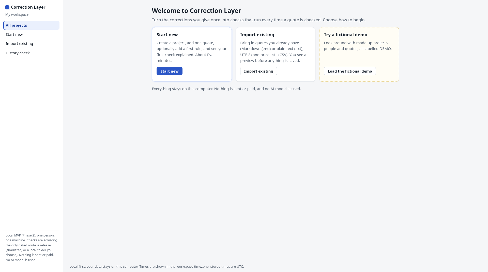

*The empty workspace offers three ways in. Click **Start new**. The line under the cards says it plainly: everything stays on this computer, nothing is sent or paid, and no AI model is used.*

### 2. Create the project

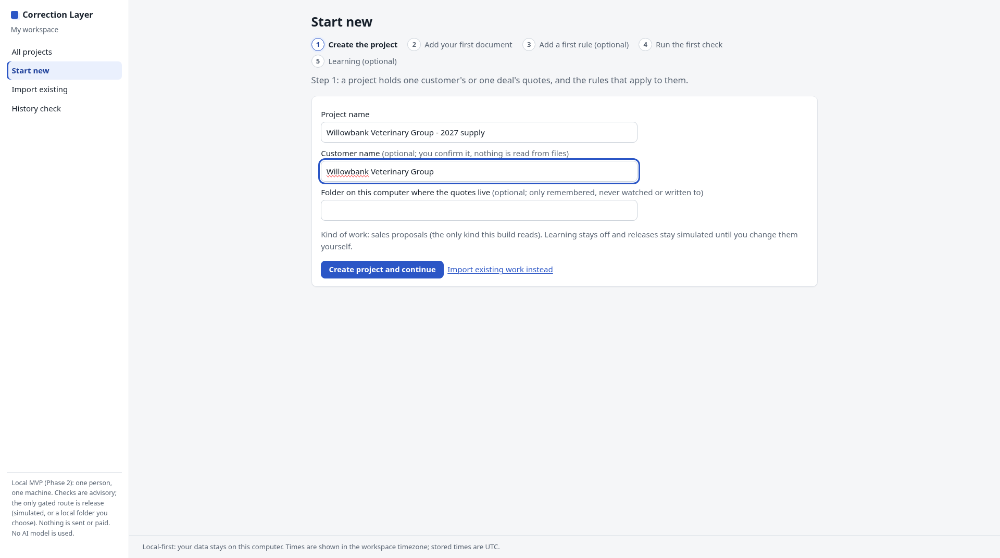

*Type a **Project name** (here `Willowbank Veterinary Group - 2027 supply`) and, optionally, a **Customer name** (`Willowbank Veterinary Group`). The folder field was left blank. Learning stays off and releases stay simulated until you change them yourself. Click **Create project and continue**.*

### 3. Add your first document

Choose [examples/readme-walkthrough/01-usd/Willowbank-Quote-2027-01.md](../examples/readme-walkthrough/01-usd/Willowbank-Quote-2027-01.md) (Markdown or plain text, UTF-8) and click **Add document**. The app shows what it read: customer Willowbank Veterinary Group, quote reference WV-2027-014, valid until 2027-03-18, total **USD 5,700.00**, and 2 pricing table lines. Check that this matches the file: every check works on what was read.

### 4. Add an optional first rule

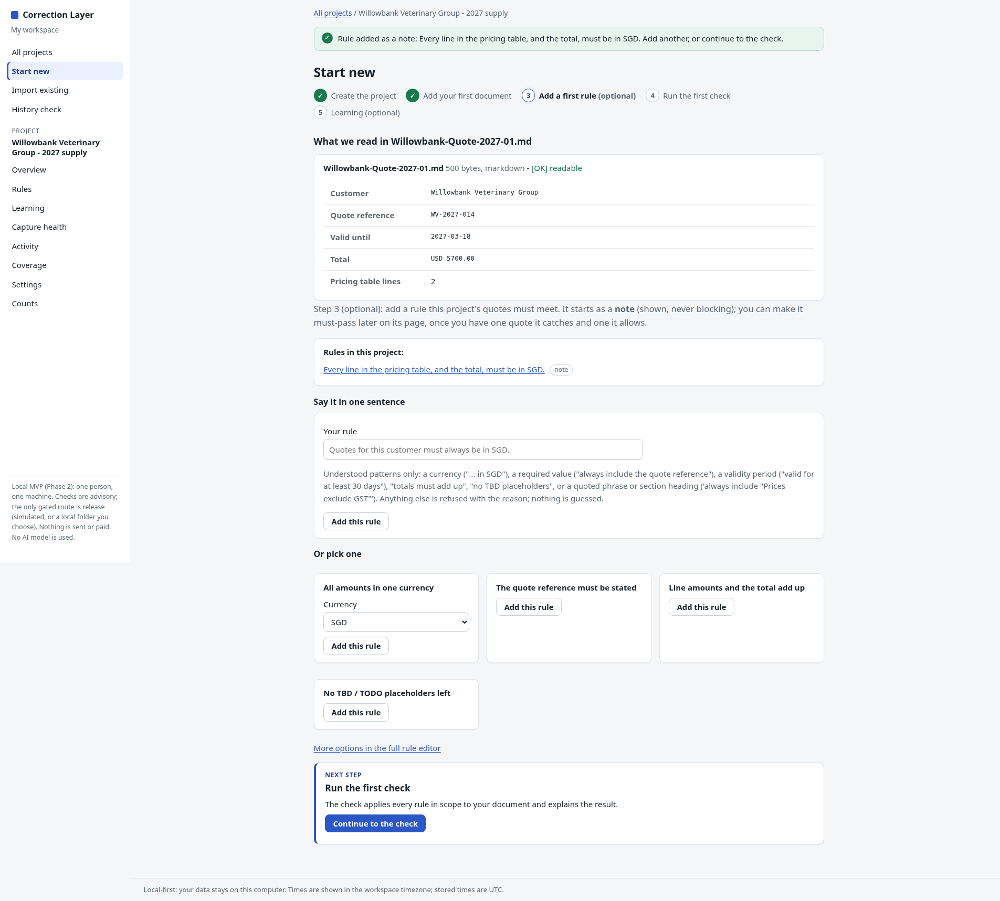

*Under **Or pick one**, in **All amounts in one currency**, leave the currency at **SGD** and click **Add this rule**. The confirmation reads "Rule added as a note". Under "Rules in this project" the rule carries a **note** badge, not must-pass. Then click **Continue to the check**.*

### 5. Run the first check and read the result

On step 4 the Willowbank quote, version 1, is already selected. Click **Run the check**.

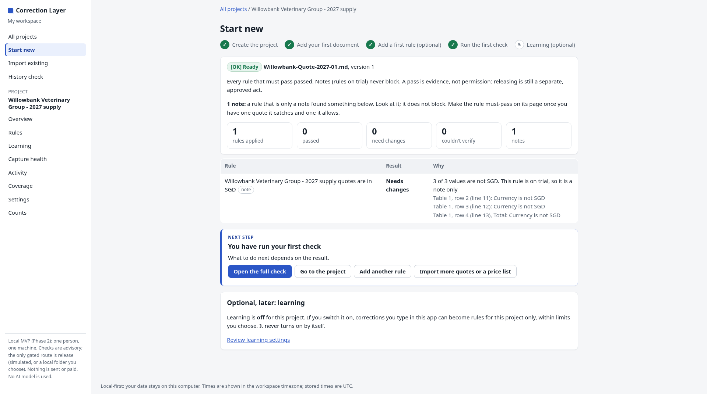

*The result is **[OK] Ready** with **1 note**. That is correct, not a mistake: the SGD rule is only a note, so it reports the problem without blocking. Its explanation says "3 of 3 values are not SGD": table rows 2 and 3, and the total in row 4. The page also says "A pass is evidence, not permission". The learning card at the bottom confirms learning is **off** for this project. Click **Open the full check**.*

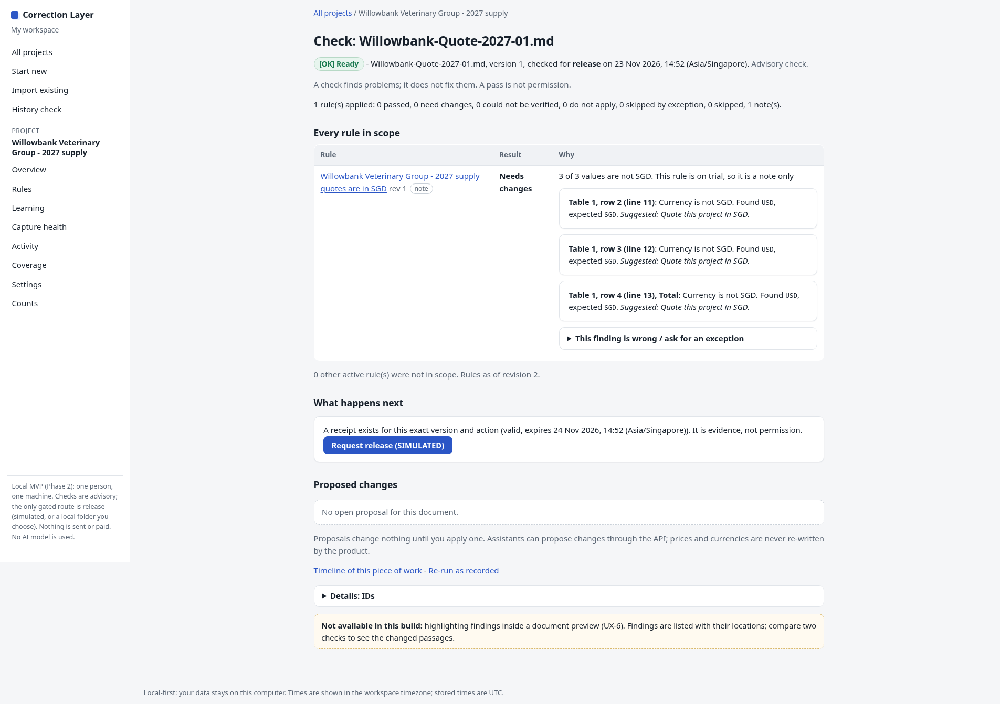

*The full check lists every rule in scope, each finding with its location ("Table 1, row 2 (line 11)") and a suggested fix. A check finds problems; it does not fix them. The receipt box says the receipt "is evidence, not permission". The **Request release (SIMULATED)** button was not used.*

### 6. Import the corrected quote and an addendum

Open **Import existing** from the sidebar. Keep the Willowbank project selected, choose both [02-sgd-corrected/Willowbank-Quote-2027-01.md](../examples/readme-walkthrough/02-sgd-corrected/Willowbank-Quote-2027-01.md) and [Willowbank-Addendum-2027-02.md](../examples/readme-walkthrough/Willowbank-Addendum-2027-02.md), and leave "If a document with the same name already exists" at **Add it as a new version**.

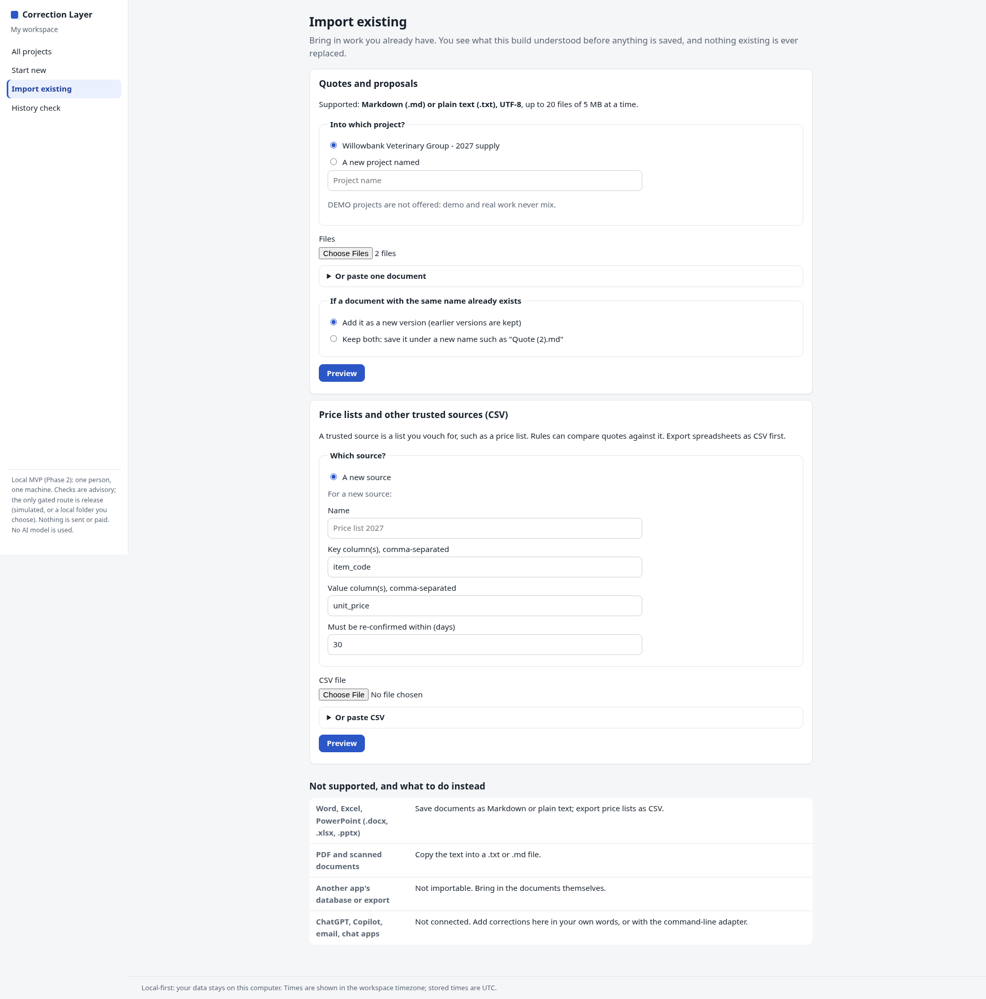

*Under **Quotes and proposals**, click **Preview**. The bottom of the page lists what is **not supported**: Word, Excel and PowerPoint files (save them as Markdown or plain text, and export price lists as CSV), PDFs and scanned documents (copy the text into a .txt or .md file), and another app's database (not importable). Assistants, email and chat apps are not connected.*

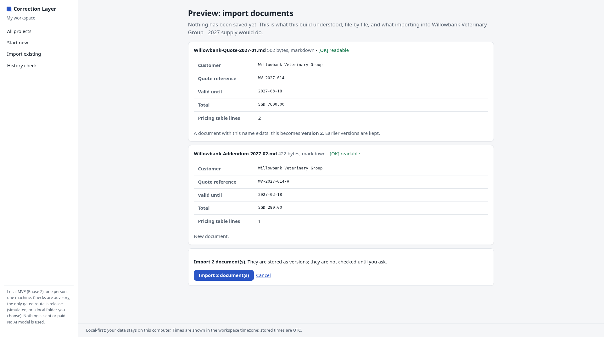

*Nothing has been saved yet. The corrected quote has the same name, so it **becomes version 2** (total SGD 7,600.00), and earlier versions are kept. The addendum is a **new document** (SGD 280.00). Click **Import 2 document(s)**.*

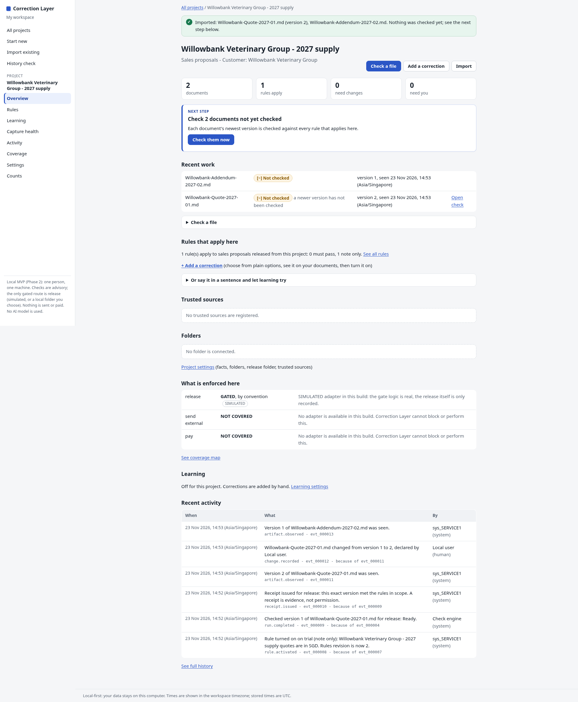

*Both files are stored, and both are marked **Not checked**. Importing never checks anything by itself. Leave **Check them now** for step 8. This page also shows what is enforced: release is GATED but SIMULATED, and send and pay are NOT COVERED.*

### 7. Import a price list (CSV)

Open **Import existing** again and scroll to **Price lists and other trusted sources (CSV)**.

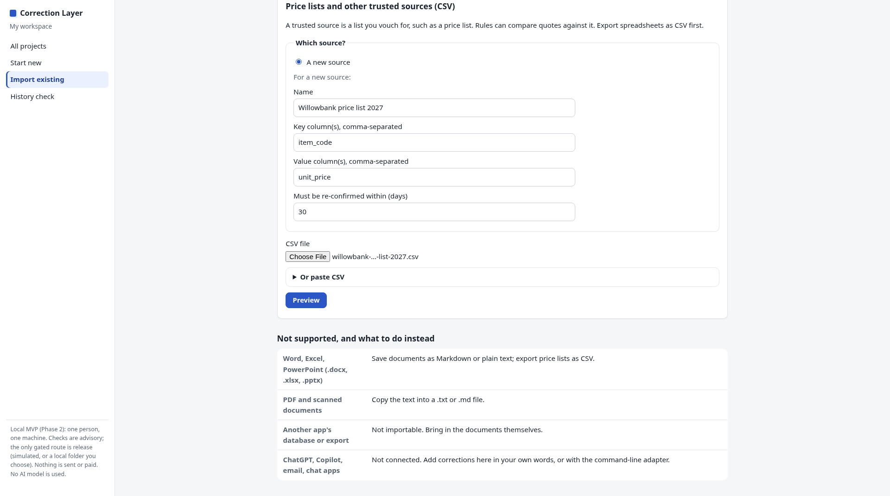

*Choose **A new source**, name it `Willowbank price list 2027`, keep the key column `item_code`, the value column `unit_price` and 30 days, choose [willowbank-price-list-2027.csv](../examples/readme-walkthrough/willowbank-price-list-2027.csv), and click **Preview**.*

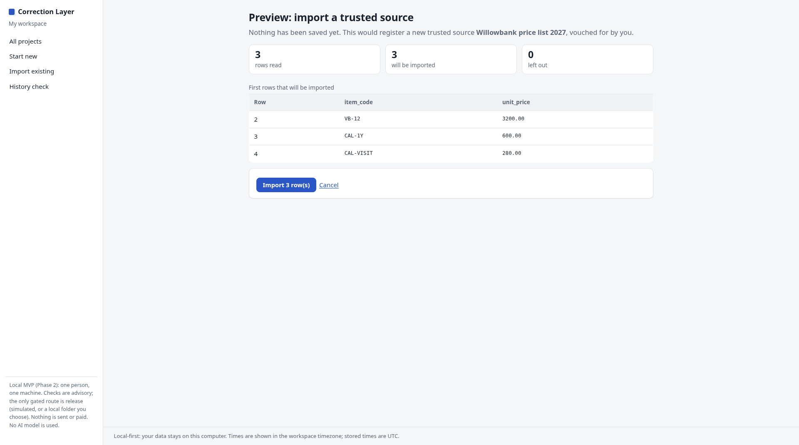

*Nothing is saved yet: 3 rows read, 3 will be imported, 0 left out. Rows that cannot be read are listed and left out; they are never read as zero. Click **Import 3 row(s)**. The source page then shows 3 of 3 rows imported. (No price rule uses this list in this walkthrough. To make quotes match it, add a rule such as "Unit prices must match a trusted price list".)*

### 8. Check again

Go back to the project (**Overview** in the sidebar) and click **Check them now**. Both new documents are checked. Open the check of the quote's version 2.

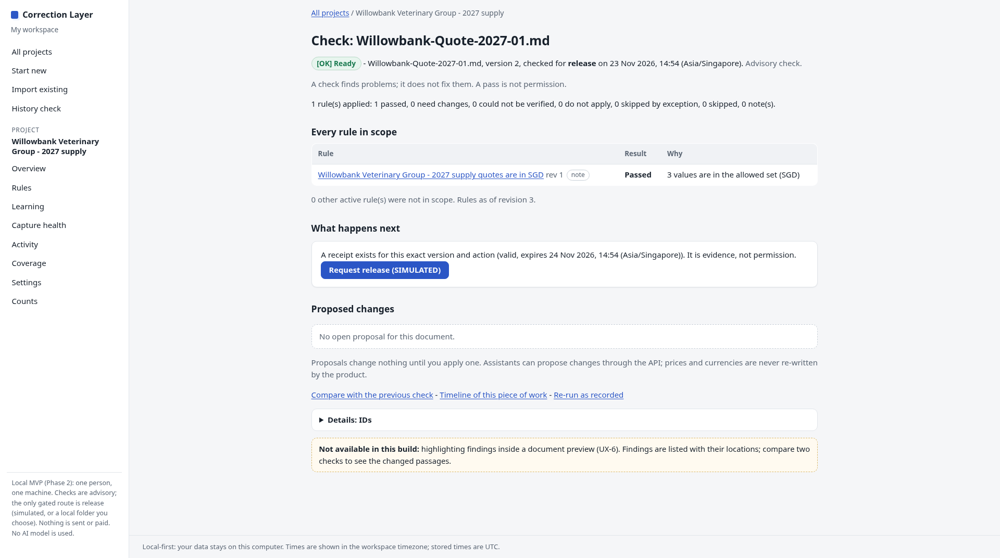

*Version 2 is **Ready** and the SGD rule now **Passed**: "3 values are in the allowed set (SGD)", with 0 notes left. The receipt is again evidence, not permission, and release was not requested. Click **Compare with the previous check**.*

### 9. Compare before with after

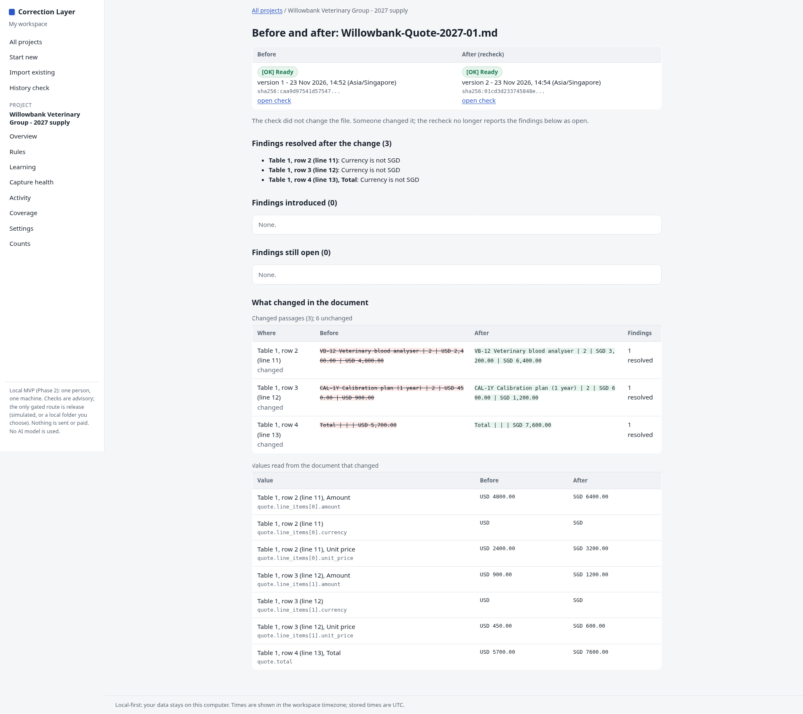

*The comparison shows **3 findings resolved**, **0 introduced** and **0 still open**, and exactly which lines and values changed: USD 2,400.00 → SGD 3,200.00, USD 450.00 → SGD 600.00, total USD 5,700.00 → SGD 7,600.00. The page says plainly that the check did not change the file: a person did, and the recheck no longer reports those findings.*

More screenshots from the same session (in-between steps and the final project page)

**Start new, step 1, before typing.** The five steps are listed at the top: create the project, add your first document, add a first rule (optional), run the first check, learning (optional).

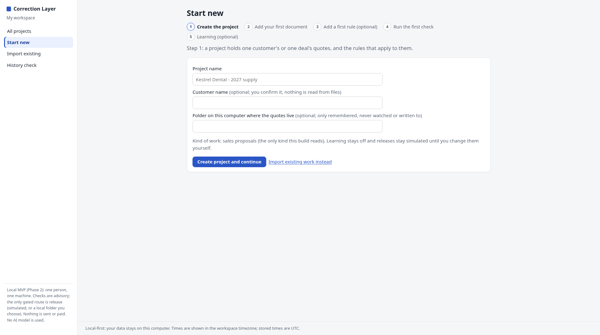

**Step 2, add your first document.** Upload a Markdown or plain-text file, or paste the text.

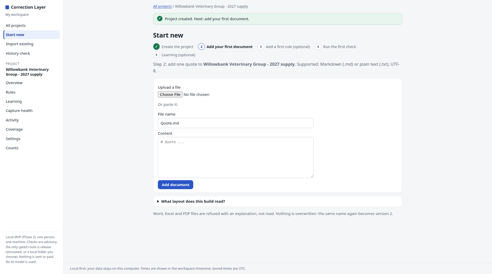

**Step 2, file chosen.** The USD quote is selected; nothing is stored until you click **Add document**.

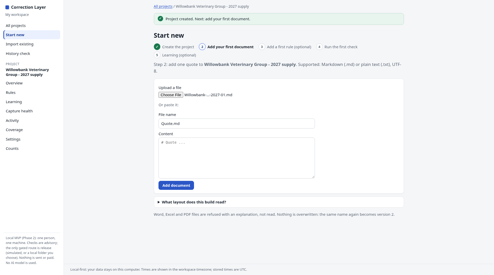

**Step 3, what was read, before adding a rule.** Every rule starts as a note. The sentence box understands a few fixed patterns only, and refuses anything else with the reason; nothing is guessed.

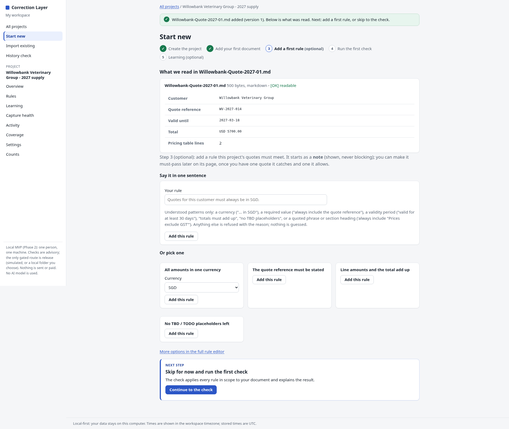

**Step 4, run the first check.** Version 1 of the quote is selected; the check is advisory.

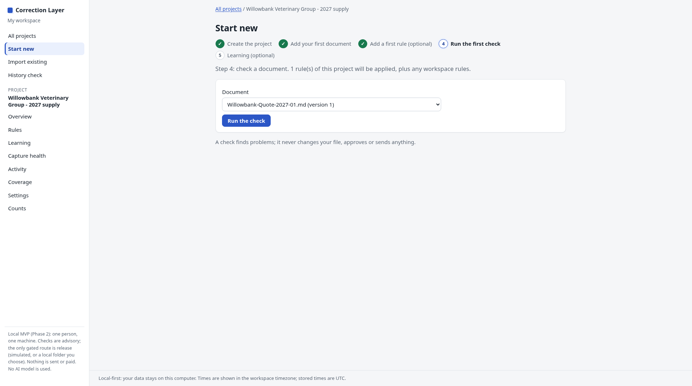

**The price list after Import 3 row(s).** 3 of 3 rows imported; every row was usable.

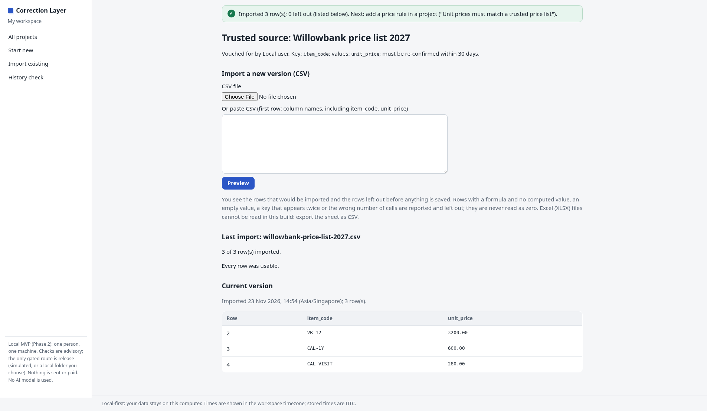

**The project at the end.** Both documents are Ready, the trusted source is listed, one rule applies (a note, 0 must-pass), learning is still off, and send and pay are NOT COVERED.

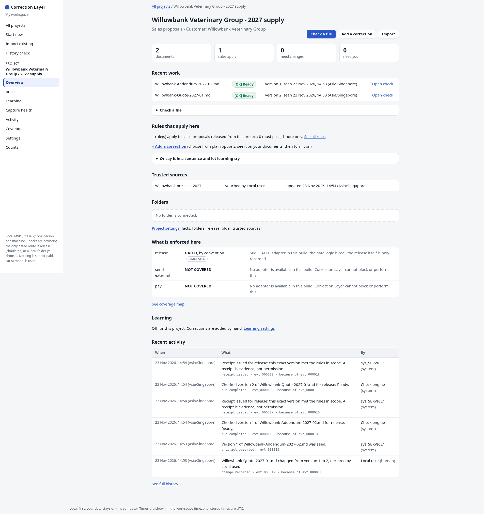

**What this walkthrough did not do.** It did not switch learning on, request a release, or make the rule must-pass. Send and pay do not exist in this build. Word, Excel, PowerPoint and PDF files are not read (see the Not supported table in step 6). [HANDOFF.md](../HANDOFF.md) lists what is real and what is simulated.
